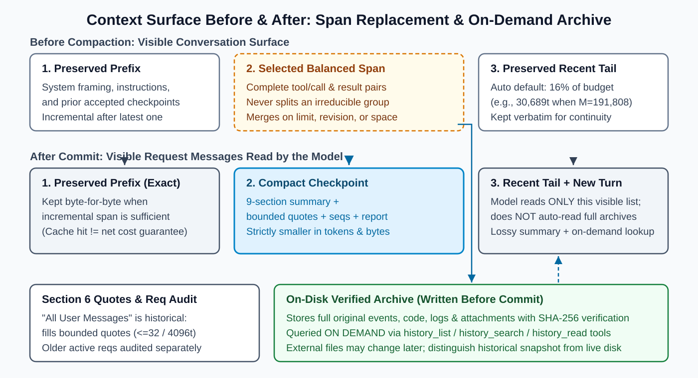
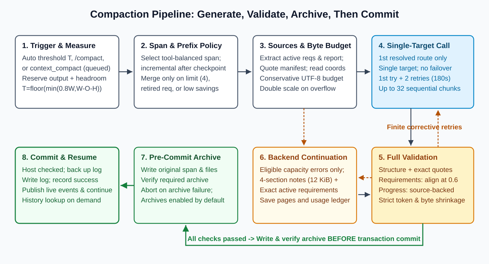
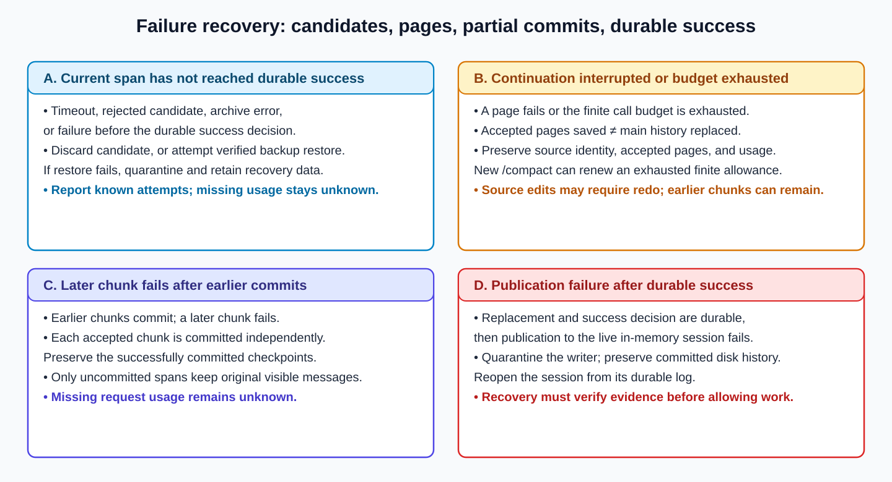

[简体中文](../principles.md) · [English](principles.md)

# DSH Compaction Weave Principles (`0.3.2-rc.2`)

DSH Compaction Weave condenses earlier conversation history into structured checkpoints that preserve the current goal, active user requirements, completed progress, and the next step, while storing replaced original messages and attachments in a local archive under the default configuration. This document explains the context layout, budget formulas, execution pipeline, validation rules, and recovery boundaries in `0.3.2-rc.2`.

---

## 1. Core Role: Visible Context Compaction and Local Archiving

In DeepSeek Harness, the host assembles the current **visible message surface** for each reasoning turn without re-reading the entire disk archive automatically. As a conversation grows toward its context budget limit, Weave selects an earlier, tool-balanced span of visible history and folds it into a single structured **checkpoint message**. With local archiving enabled by default (`archiveEnabled: true`), the replaced original events, long code snippets, tool outputs, and attachments are written to the local disk archive before replacement and can be queried on demand through `history_list`, `history_search`, and `history_read`.

If `archiveEnabled: false` is explicitly configured, Weave does not write local archive files during compaction, the `history_*` lookup tools are not registered, and backend continuation paging is unavailable. The `context_compact` tool can still be registered when `proactiveEnabled: true`, but calling it returns `blocked` at the request stage because archiving and history lookup tools are unavailable. In addition, whenever a candidate span would evict earlier user quotes outside the Section 6 recent verbatim quote budget, quote-loss protection blocks compaction so unarchived user quotes are not dropped. The remainder of this document describes the default `archiveEnabled: true` workflow.

As shown above, after a standard compaction commit, the visible context consists of three regions:

1. **Preserved Prefix**: The system prompt, runtime instruction frame, and any previously committed checkpoints. In incremental compaction mode, this prefix is preserved byte-for-byte to keep the context prefix stable.
2. **Compact Checkpoint**: A single user-side structured message replacing the selected history span. Alongside the model-generated nine-section summary, the engine deterministically fills bounded recent verbatim user quotes, source event sequences and SHA-256 digests, validated progress facts, and a bounded envelope for the latest assistant work report in the span.
3. **Preserved Recent Tail**: The most recent raw interaction turns at the end of the conversation, keeping 16% of the message budget by default on the automatic path so the conversation continues smoothly.

---

## 2. Triggers, Window Math, and Capacity Planning

### 2.1 Three Trigger Entry Points and Receipt Statuses

Weave supports automatic checks, manual commands, and model-initiated phase wrap-up requests:

| Entry point | How it starts | Conditions and default thresholds | Outcome |
| :--- | :--- | :--- | :--- |
| **Automatic compaction** | Checked at a safe step before a main model request | `auto: true`, current input reaches trigger threshold $T$, and growth since last compaction meets `minGrowthTokens` (default `0`) | Runs automatically when thresholds are met; skips or enters backend continuation paging if constrained by the retained tail or an oversized tool group |
| **Manual compaction (`/compact`)** | User enters `/compact` in chat | Independent of the automatic trigger threshold; also grants a fresh extra-call batch when a paused backend continuation is resumed | Returns the compaction result, remaining page progress, or the specific failure reason directly |
| **Phase wrap-up request (`context_compact`)** | Model calls the tool after finishing a task phase | `proactiveEnabled: true`, a 1–240 character reason is provided, and archiving plus history lookup tools are available | Returns `status: 'queued'` when eligible and evaluates the request at the next safe step after the current tool batch finishes; returns `blocked` immediately if archiving support is unavailable |

Two operational details apply to phase requests and manual commands:

- **`queued` records a pending request; check the final result after the safe step**: When `context_compact` returns `queued`, the current tool batch is still running and compaction has not happened yet. When the request is consumed at the next safe step, it returns `blocked` if the plugin has stopped; `skipped` if the session is busy, new user input arrived, total context is below `proactiveMinTokens` (default `8192`), growth since the last anchor is below `proactiveMinGrowthTokens` (default `4096`), or no eligible span is available; or `cancelled` if the conversation turn changed (an `AbortSignal` mid-run throws directly without guaranteeing a final receipt). Once compaction runs, it finishes as `compacted` (committed), `partial` (partially committed before an error), or `failed` (stopped by validation, protection, or request errors before any commit).
- **Unified `/compact` command**: `0.3.2-rc.2` removes the legacy standalone `/context-continue` command registration. Use `/compact` both to start manual compaction and to resume remaining pages after a paused backend continuation.

### 2.2 Automatic Trigger Threshold and 20% Reduction Target Formulas

The configured `thresholdRatio: 0.8` combines with next-reply output reservation and headroom to determine the trigger point. Let:

- $W$ be the safe context window for the main session. Initial resolution prefers an explicit window mapping, then adapter window metadata, and otherwise a configured fallback of at least `65536` (default `200000`). During a session, the independent safe window only tightens and never expands, and an explicit trusted smaller window is not raised to the fallback floor.
- $O$ be the **output reservation for the next main assistant reply** (`reservedCompletionTokens`), which is independent of the summary model's output limit (`maxTokens`, default `8192`).
- $M = W - O$ be the message budget (`messageBudgetTokens`).
- $H$ be the effective headroom (`effectiveHeadroom`): `headroomTokens = 33000` by default, or $\lfloor M \times 0.25 \rfloor$ whenever $H \ge M$ on smaller windows.
- $P = M - H$ be the pressure budget (`pressureBudgetTokens`).

Under the default ratios (`thresholdRatio = 0.8`, `retainRatio = 0.16`, `minimumReductionRatio = 0.2`), the automatic trigger threshold $T$, preserved recent tail $R$ when `retainTokens` is not explicitly set, and automatic target total input $D$ are computed as:

$$T = \lfloor \min(W \times 0.8,\ M - H) \rfloor$$

$$R = \lfloor M \times 0.16 \rfloor$$

$$D = \min(T - 1,\ \lfloor \text{currentInput} \times 0.8 \rfloor)$$

In general configuration terms, these correspond to $W \times \text{thresholdRatio}$, $M \times \text{retainRatio}$, and $\text{currentInput} \times (1 - \text{minimumReductionRatio})$.

**Worked example**: With defaults $W = 200000$, next-reply output reservation $O = 8192$, `thresholdRatio = 0.8`, `headroomTokens = 33000`, `retainRatio = 0.16`, and `minimumReductionRatio = 0.2`:

1. Message budget: $M = 200000 - 8192 = 191808$ tokens.
2. Effective headroom and pressure budget: $H = 33000$ tokens, $P = 191808 - 33000 = 158808$ tokens.
3. Automatic trigger threshold: $\min(200000 \times 0.8,\ 158808) = \min(160000,\ 158808) = 158808$, so $T = 158808$ tokens.
4. Preserved recent tail: $R = \lfloor 191808 \times 0.16 \rfloor = 30689$ tokens.
5. Automatic target total input: When `currentInput = 170000` exceeds $T$, $D = \min(158807,\ \lfloor 170000 \times 0.8 \rfloor) = 136000$ tokens, planning at least a 20% input reduction.

### 2.3 Main Context Metering vs. Summary Request Byte Budgeting

Weave uses distinct metering rules for the main conversation and for summary requests:

- **Main session context metering**: Prefers host-provided estimates or per-message costs amortized from historical request `usage`, falling back to heuristic text estimation (`approxTokens`) when unavailable.
- **Summary request capacity planning**: When assembling a complete summary request (source messages, prompt template, active requirements, work report, and progress facts), each serialized **UTF-8 byte** counts as 1 conservative budget unit. With summary window $\text{summaryWindow}$, summary output cap $\text{output}$, safety margin $\text{margin} = \min(\text{headroomTokens},\ \lfloor \text{summaryWindow} / 4 \rfloor)$, default input ratio `0.75`, and default per-request byte cap `458752` (448 KiB; both `0.75` and `458752` are default values of configurable parameters), the available window is clamped to non-negative first and the single-request byte limit is:
  $$\text{Limit} = \left\lfloor \frac{\min(\max(0,\ \text{summaryWindow} - \text{output} - \text{margin}) \times 0.75,\ 458752)}{\text{scale}} \right\rfloor$$
  Starting from $\text{scale} = 1$, if the provider still returns `CONTEXT_WINDOW_EXCEEDED`, the engine records any disclosed window cap, doubles $\text{scale}$ to halve the allowed per-request capacity, and re-selects a smaller span while keeping individual source messages intact rather than truncating message bodies mid-text.

---

## 3. Span Selection, Incremental Prefix Preservation, and Requirement Lifecycle

### 3.1 Tool Pairing Balance and Incremental Checkpoint Policy

When selecting a history span to compact, Weave enforces two core rules:

1. **Paired tool calls and results move together**: Every `tool/call` and its matching `tool/result` must either remain in the preserved region together or be included in the compacted span together, preventing dangling tool messages.
2. **Incremental compaction after the latest checkpoint first**: `cachePreservePrefix: true` is enabled by default. When earlier checkpoints exist, as long as a tool-balanced span after the latest checkpoint yields net savings of at least `savingNeeded = max(cacheMinSavingsTokens [default 4096], targetReduction)`, the engine leaves the latest checkpoint and everything before it untouched and compacts only the newer history into a new checkpoint.

Earlier checkpoints are folded into a full consolidation only when one of three conditions holds:
- The number of existing checkpoints reaches `cacheMaxCheckpoints` (default `4`);
- A later user turn revises (`superseded`) or explicitly cancels (`cancelled`) an earlier requirement that resides inside an older checkpoint;
- The incremental span after the latest checkpoint cannot free the minimum required space after subtracting the new checkpoint size.

After compaction commits, the next main conversation turn proceeds as a normal cold read without sending extra cache-prewarming requests.

### 3.2 Section 6 ("All User Messages") and Independent Requirement Auditing

Standard checkpoints follow a fixed nine-section Markdown template:
1. `Primary Request and Intent` (`用户的核心请求与意图`)
2. `Key Technical Concepts` (`关键技术概念`)
3. `Files and Code Sections` (`涉及的文件与代码`)
4. `Errors and Fixes` (`错误与修复`)
5. `Problem Solving` (`问题解决过程`)
6. `All User Messages` (`全部用户消息`)
7. `Pending Tasks` (`待办任务`)
8. `Work Completed` (`已完成的工作`)
9. `Context for Continuing Work` (`继续工作所需的上下文`)

A soft length target of `4000` characters guides concise prose in the model-generated summary body while requiring all active facts and constraints to be preserved.

Section 6 retains the historical template heading **`## 6. All User Messages` (`## 6. 全部用户消息`)**, and works alongside the preserved recent tail $R$ and independent requirement auditing:

- **Deterministic recent verbatim quote budget**: The summary model outputs only the placeholder `[filled by engine]` or `[由引擎填充]` in Section 6. After the model responds, the engine deterministically fills **selected recent user quotes within budget** (up to `preserveRecentMessages: 32` messages and `preserveRecentUserTokens: 4096` estimated tokens by default) verbatim in chronological order. Brief nudges such as "continue" or "ok" do not consume quote budget; when the budget is tight, the oldest complete quotes are dropped first. This quote budget is independent of the preserved recent tail $R$ at the end of the conversation.
- **Independent tracking of earlier active requirements**: Under default archiving, earlier user messages that age out of the Section 6 verbatim quote budget remain stored in full in the local disk archive. Meanwhile, the memory selector tracks each user requirement's lifecycle by event sequence across active, superseded, explicitly cancelled, target object, and environment scope states. As long as an earlier requirement has not been superseded or cancelled, it remains an **active requirement** enforced by the independent post-summary requirement audit, or preserved verbatim under `## Preserved source requirements` in backend continuation mode. Requirements explicitly cancelled by the user—along with the cancellation directive itself—are excluded so retired constraints are not reintroduced (`RETIRED_MEMORY_REINTRODUCED`).

---

## 4. Execution Pipeline, Single-Target Routing, and Backend Continuation Paging

### 4.1 Five-Step Standard Compaction Pipeline

Under the default configuration, standard compaction follows a strict sequence—generate and validate in memory first, write the archive second, and commit the surface replacement last:

1. **Span selection and source extraction**: Select a tool-balanced span and extract active requirements, bounded recent verbatim user quotes, progress facts, and the latest assistant work report in the span.
2. **Candidate summary generation**: Request a nine-section candidate summary from the resolved summary target.
3. **Full in-memory validation**: Fill Section 6 verbatim quotes, assemble the complete checkpoint block, and run nine-section structure validation, retired-memory checks, quote coverage verification, strict dual size-reduction checks (estimated tokens and canonical UTF-8 bytes), progress fact validation, and requirement auditing (including deterministic requirement line reconstruction when applicable).
4. **Archive write and read-back verification**: Once all checks pass, write the original events and attachments for the span to the local archive and verify event counts and sequences on read-back when required.
5. **Transactional commit and surface publish**: Perform the persistent replacement backed by a `.rollback` copy and transaction journal, then publish the updated message surface in memory.

If candidate generation, audit validation, or archive writing fails, the pipeline aborts immediately and the visible conversation history remains unchanged.

### 4.2 Single-Target Routing and Bounded Retries

The summary target is resolved in order of priority: (1) explicitly configured `summarizationProvider` and `summarizationModel`; (2) the session's persisted model route; (3) the active agent's declared model route. Sampling parameters such as `reasoningEffort`, `temperature`, and `stop` are reused only when the summary target's `provider/model` matches the main conversation route exactly.

Summary requests always run with `singleTarget: true`: **Weave calls only the first resolved summary target and does not fall back across providers or models on failure**. Each candidate summary chunk or continuation page has **1 initial request + up to 2 retries** by default (`summaryRetryCount: 2`, 3 attempts total), with a per-attempt timeout of `summaryTimeoutMs = 180000` (180 seconds) and exponential backoff (`1s`, `2s`, capped at `30s`). Retryable transport errors and audit-triggered feedback regenerations share this retry budget; an `AbortSignal` stops execution immediately.

### 4.3 Bounded Chunks vs. Backend Continuation Paging

For large histories, Weave distinguishes between standard bounded chunks and backend capacity continuation paging:

| Dimension | Standard Bounded Chunks | Backend Continuation Paging |
| :--- | :--- | :--- |
| **Trigger condition** | Standard span selection advances across bounded chunks, up to `maxSummaryChunks: 32` | Standard compaction hits a capacity or size rejection (`SUMMARY_NOT_SMALLER`, `SUMMARY_GROUP_TOO_LARGE`, `SUMMARY_BATCH_LIMIT`, `COMPACTION_CAPACITY_BLOCKED`, or `SUMMARY_ALL_FAILED` composed entirely of those codes) while archiving and history lookup tools are available |
| **Output structure** | Nine-section checkpoint + Section 6 recent verbatim quotes | Four-section working notes (`Goal`, `State`, `Next`, `Uncertain`) + verbatim `## Preserved source requirements` |
| **Size caps** | Complete checkpoint must be strictly smaller than the shadowed span in both estimated tokens and canonical UTF-8 bytes | Working notes capped at `continuationMemoryBytes: 12288` B (12 KiB); full replacement capped at `continuationMaxBytes: 98304` B (96 KiB), up to 32 pages |
| **Commit timing** | **Commit per chunk**: each chunk replaces its span immediately after passing validation and archiving | **Commit after all pages finish**: accepted pages and call ledgers are persisted on disk during paging, and the visible history is replaced only after all pages complete and pass full-replacement validation |

---

## 5. Strict Size Reduction, Requirement Auditing, and Progress Validation

### 5.1 Dual Strict Size-Reduction Check on Complete Checkpoints

After assembling the complete checkpoint block (summary body, Section 6 recent verbatim quotes, latest work-report envelope, and progress facts), the engine enforces two strict inequalities:

1. **Strictly fewer estimated tokens**: `checkpointTokens < shadowedTokenCount`;
2. **Strictly fewer canonical UTF-8 bytes**: `checkpointCanonicalBytes < shadowedCanonicalBytes`.

If either metric is greater than or equal to the replaced span, the candidate is rejected with `SUMMARY_NOT_SMALLER`, preventing metadata or verbatim quotes from inflating the context.

### 5.2 Requirement Auditing, Progress Validation, and Deterministic Line Reconstruction

- **Requirement Audit**: Checks lexical alignment coverage, exact numbers, negation polarity (ensuring prohibitions are not flipped into affirmative statements), conditions, and target scopes for all active user requirements. The default `auditCoverageThreshold: 0.6` is a **per-requirement lexical alignment threshold** used to determine whether a summary line corresponds to a source constraint, rather than an overall quality score. With `auditBlockOnLoss: true` by default, polarity flips (`CONSTRAINT_POLARITY_LOST`) or missing active constraints (`CONSTRAINT_LOST`) block commit.
- **Progress Validation**: Independently extracts quantifiable counts, same-batch target objects, artifact paths and completion states, and next steps, rejecting candidates with `PROGRESS_FACT_CONFLICT` when they contradict the latest source state. The engine also extracts the latest assistant work report in the span (`work-report`, capped at `3072` bytes with event sequence and SHA-256; oversized or superseded reports are converted into source coordinate pointers).
- **Deterministic Requirement Line Reconstruction**: When a candidate fails only requirement auditing with no `PROGRESS_FACT_CONFLICT`, the engine can deterministically reconstruct missing or disputed constraint lines locally from source user messages (up to 8 iterations, at most 16 removed line fingerprints, and at most `8192` B total growth) and re-run full structure, progress, and dual size-reduction checks from scratch.
- **External Read Coordinate Projection**: When building summary request inputs, skill catalogs (`skill-catalog`), runtime context (`runtime-context`), and file or web read outputs (`read`, `read_file`, `ops_read_files`, `read_page`, `memory_get`, `skill`) are projected into compact retrieval coordinate pointers so large file payloads do not exhaust the summary window while full contents remain in the disk archive.

---

## 6. Transactional Protection and Four Recovery Boundaries

How Weave handles failures depends on where in the pipeline the interruption occurs, with the persistent transaction commit decision serving as the primary boundary:

1. **Stage A: Failure before commit or before the persistent commit decision**
   - On model timeout, audit rejection, or archive write failure, surface replacement has not started and the visible message list is untouched.
   - Once transactional commit begins, the engine verifies the `DSH 0.2.2-rc.1` host storage method fingerprints, synchronously copies and `fsync`s the session JSONL to a `.rollback` backup, and writes `.tail` plus transaction journal state `phase: 'committing'`. If any error or cancellation occurs before `phase: 'committed'` (the persistent commit decision `decided = true`) is written, the engine atomically restores the original session file from `.rollback`; if restoration itself fails, recovery artifacts are preserved and further writes to the session are quarantined.
2. **Stage B: Backend continuation interrupted or extra-call budget exhausted**
   - After each validated continuation page, the page's source SHA-256, latest four-section working notes, latency, and `usage` are persisted to `continuation-progress`.
   - If an error occurs or the extra-call budget (default `continuationMaxExtraCalls: 4`) is exhausted, accepted pages stay on disk and the main conversation history is not replaced yet. Running `/compact` later grants a fresh bounded call batch and resumes from the first unfinished page if source messages and key settings are unchanged, or recomputes paging while preserving prior call accounting if the source changed.
3. **Stage C: Later-chunk failure during standard multi-chunk compaction (`partial`)**
   - Standard bounded-chunk compaction advances up to `32` chunks, archiving and committing one chunk at a time. If earlier chunks commit and a later chunk fails, the committed chunks remain as checkpoints, the failed span stays as raw messages, and the operation returns `partial`.
4. **Stage D: In-memory surface publish failure after persistent disk commit**
   - Once the transaction journal records `phase: 'committed'`, the new session file on disk is authoritative. If publishing the updated surface in memory subsequently fails (`COMPACTION_SURFACE_PUBLISH_FAILED`), the engine does not roll the disk back to the old file; instead, it immediately quarantines further writes on the in-memory session and reopens the session from the committed disk state.

---

## 7. Risks and Applicable Scope

To help evaluate Weave for your workflow, key boundaries across quality, capacity, recovery, and billing are summarized below:

- **Lossy summarization and semantic detection boundaries**: A checkpoint is an audited lossy summary paired with on-demand archive lookup. `0.3.2-rc.2` fixes reproduced false rejections around superseded historical snapshots and coordinated negation scope, but natural language varies widely, and complex indirect negations or cross-sentence implicit references can still cause false rejections or missed detections. Assistant `work-report` blocks record historical assistant reports with source coordinates rather than independent external verification, and archived file-read snapshots reflect the state at the time of reading rather than current disk contents.
- **Capacity targets and tokenization boundaries**: The default 20% minimum reduction (`minimumReductionRatio: 0.2`) is an automatic planning target. When the system prompt, preserved recent tail $R$, or an indivisible oversized tool group dominates the window, a single compaction may be unable to free 20% and will skip or switch to backend continuation. Both main-context token estimation and summary-request UTF-8 byte budgeting are conservative engineering approximations rather than provider-native tokenizers.
- **Recovery and multi-chunk boundaries**: Backend continuation paging does not replace visible history until all pages complete; standard multi-chunk compaction can stop in a `partial` state if a later chunk fails; an in-memory publish failure after disk commit requires reopening the session from disk; and if `.rollback` atomic restoration itself fails, session writes are quarantined with recovery files preserved for inspection.
- **Token reduction vs. API billing boundaries**: Reducing single-turn input tokens differs from reducing total API spend. Total cost depends on the summary calls themselves, audit-triggered regenerations, cache-prefix shifts on the first reply after compaction, and each provider's billing rules. See [Testing](testing.md) for multi-model paired experiments, the GLM proxy-rate cost scenario, and full cost tables.

---

## 8. Code and Evidence Navigation

For implementation details, see [Architecture](architecture.md), [Configuration](configuration.md), [Testing](testing.md), [Troubleshooting](troubleshooting.md), and [Reporting & redaction](feedback.md), along with the core modules under `lib/` (each source file is linked once):

- Plugin entry point, command registration, and tool registration: [../../lib/index.js](../../lib/index.js)
- Configuration parsing and window trigger budget formulas: [../../lib/config.js](../../lib/config.js), [../../lib/window.js](../../lib/window.js)
- Main compaction pipeline and chunk orchestration: [../../lib/engine.js](../../lib/engine.js)
- Cache-prefix preservation policy and tool-balanced span selection: [../../lib/cache-policy.js](../../lib/cache-policy.js), [../../lib/region.js](../../lib/region.js)
- User requirement lifecycle tracking and Section 6 recent quote selection: [../../lib/memory-policy.js](../../lib/memory-policy.js)
- Requirement alignment auditing, progress fact validation, and deterministic line reconstruction: [../../lib/audit.js](../../lib/audit.js), [../../lib/progress-facts.js](../../lib/progress-facts.js), [../../lib/reconstruct.js](../../lib/reconstruct.js)
- Backend capacity continuation paging and persistent progress accounting: [../../lib/continuation.js](../../lib/continuation.js), [../../lib/continuation-progress.js](../../lib/continuation-progress.js)
- Local message archive lookup and attachment storage: [../../lib/history.js](../../lib/history.js), [../../lib/attachments.js](../../lib/attachments.js)
- Persistent session transaction commits and atomic file replacement: [../../lib/transaction.js](../../lib/transaction.js), [../../lib/atomic-replace.js](../../lib/atomic-replace.js)
- Failure diagnostic metadata whitelist and audit rejection records: [../../lib/failure-diagnostics.js](../../lib/failure-diagnostics.js), [../../lib/audit-reject.js](../../lib/audit-reject.js)
