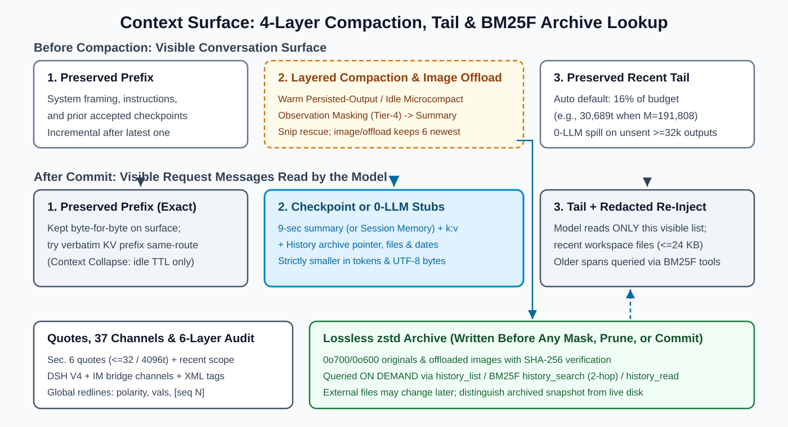
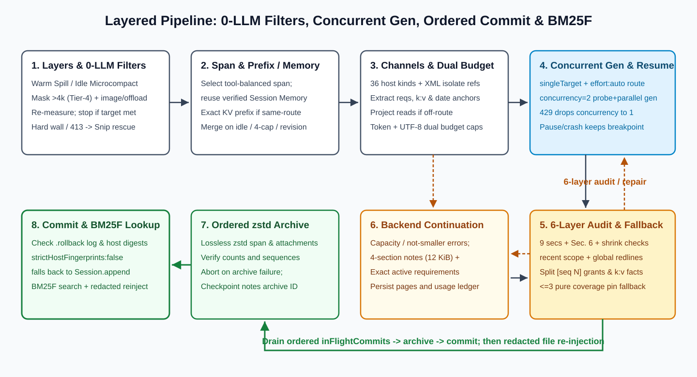
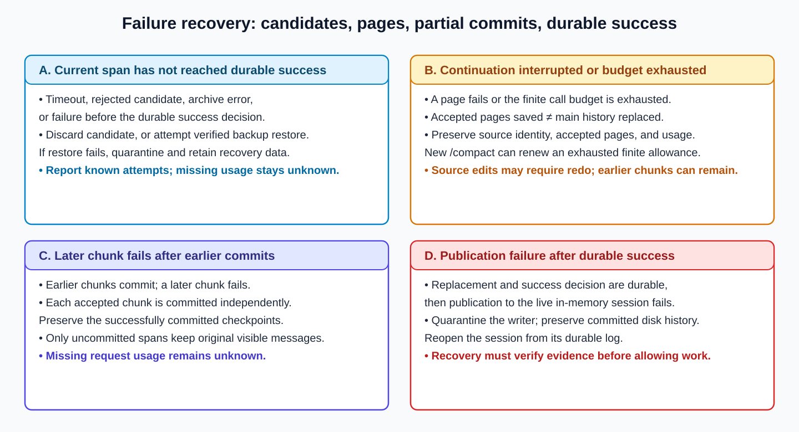

[简体中文](../principles.md) · [English](principles.md)

# DSH Compaction Weave Principles (`0.6.0`)

DSH Compaction Weave keeps long conversations manageable when history keeps growing and earlier instructions are easy to lose. Using a layered, cache-friendly execution order (zero-disruption tail spilling while warm, 0-LLM idle cleanup before cold summaries, archive-backed observation masking before checkpoint summarization under pressure, and last-resort emergency snipping near the hard limit), it condenses older turns into structured **checkpoints** that preserve the active goal, binding user requirements, completed progress, and the next step, while writing replaced original messages and attachments to a local lossless `zstd` disk archive so the model can query exact details on demand via pure-JS BM25F multi-field search and paged lookup. This document explains the 4-layer compaction pipeline, dual-watermark image offloading, budget formulas, source isolation, validation rules, redacted file re-injection, and recovery guarantees in `0.6.0`.

---

## 1. Core Role: 4-Layer Context Compaction and Local Archiving

In DeepSeek Harness (DSH), the host assembles the current **visible message surface** for each reasoning turn and does not automatically re-read full disk archives on every step. As file reads, command logs, oversized images, and old turns accumulate, the visible surface moves toward the context window limit. With local archiving enabled by default (`archiveEnabled: true`), Weave applies four strictly ordered layers (alongside dual-watermark image offloading):

1. **Layer 1 (Warm prompt cache): Persisted-Output 0-LLM tail spilling (`persistedOutputEnabled: true`)**
   - During active warm turns, Weave never mutates previously sent prefix history. It inspects only **newly landed, unsent** trailing `tool/result` nodes; any non-error block reaching `persistedOutputThresholdChars` (`32768` characters by default) is archived immediately on disk and replaced with `1200`-character head/tail previews plus a `history_read` pointer—**0 extra LLM calls and 0 prefix-cache invalidation**.
2. **Layer 2 (Expired idle TTL window): Microcompact + opt-in Context Collapse + optional idle summary**
   - When a new user turn arrives after exceeding `idleCompactionMinutes` (when upstream KV caches have likely cooled), Weave runs **Time-Based Microcompact (0 LLM)** first (`microcompactEnabled: true`): keeping the newest `4` hot tool outputs intact, folding older outputs above `2000` chars, and deduplicating repeated reads of the same path;
   - If `contextCollapseEnabled: true` (opt-in, default off), progressive **Context Collapse** runs ONLY inside this expired idle window right after microcompaction (never during warm prompt cache);
   - Only if further reduction is still required and `idleFullSummaryEnabled: true` does it run an optional full idle LLM summary.
3. **Layer 3 (Pressure / manual / proactive phase boundary): Observation Masking & Structured Checkpoint Summary (plus optional Session Memory)**
   - **Stage-1 archive-backed observation masking (`observationMaskingEnabled: true`)**: Outside the preserved recent tail—when no continuation is pending and both archiving and `history_*` lookup tools are available—Weave archives non-error `tool/result` outputs exceeding `observationMaskThresholdChars` (`4000` chars by default) and replaces them with `300`-char head/tail previews (upgraded via `tool-preview.js` Tier-4 salient prose, failure-cluster windows, code skeletons, or shallow JSON summaries) plus a `history_read` pointer. On automatic `pressure` checks, Weave **re-measures the visible surface** afterwards and skips calling a summary model whenever post-mask input is strictly below $T$ and meets the initial reduction target (`<= initialReductionTarget`); on `context-overflow`, it archives and masks oversized outputs before host tool pruning runs. Error tool results and non-text blocks are left untouched, and outputs whose provenance depth has reached `63` links or whose span would exceed `3840` source references are skipped cleanly.
   - **Structured checkpoint summary (reusing Session Memory when enabled)**: When masking alone cannot meet the target, or when triggered by `/compact`, `context_compact`, or full idle summarization, if opt-in `sessionMemoryEnabled: true` (default off) is active, foreground compaction briefly waits for and checksum-verifies an in-flight background memory summary for 0 extra LLM calls; otherwise Weave selects a tool-balanced span and runs bounded-concurrency generation with strictly ordered serial commits to fold it into a structured **checkpoint message**. Replaced originals and attachments are written to disk before commit and stay queryable via `history_list`, `history_search`, and `history_read`.
4. **Layer 4 (Hard budget wall / HTTP 413 fallback): Snip 0-LLM emergency pruning (`snipEnabled: true`)**
   - Runs ONLY as a final fallback when regular compaction, masking, and continuation fail or cannot fit and the session still approaches `messageBudgetTokens` or hits `CONTEXT_WINDOW_EXCEEDED` (413) (0 LLM calls). Snip archives the oldest tool-call/result loops into stubs with `history_read` pointers (up to `4` spans per pass requiring `>= 1024` net tokens saved) while strictly protecting the system prompt, recent user turns (`>= 2`) and working tail (`>= 8192` tokens), active constraints, and tool-pair boundaries.
- **Dual-watermark image offloading (`image/offload`)**: When un-offloaded visible images exceed `maxVisibleAttachmentBytes` (`16 MiB` default) or `maxVisibleImages` (`24` default, paired with a `>= 20` guard for images with an edge `>2000px`), Weave batch-offloads older images via native `image/offload` down to the low watermark while keeping the newest `6` hot images inline—never rewriting `user/message` turns, avoiding per-turn cache thrashing, and never resetting session-memory `callsUsed`.

If `archiveEnabled: false` is explicitly configured, disk archive writes, archive-backed folding/pruning (`Persisted-Output`, `Observation Masking`, `Microcompact`, `Snip`), `history_*` lookup tools, and backend continuation paging are disabled. The `context_compact` tool can still be registered when `proactiveEnabled: true`, but calling it returns `blocked` immediately because archiving and history lookup are unavailable. Whenever a candidate span would drop earlier user quotes outside the checkpoint's Section 6 ("All User Messages") recent verbatim quote budget, quote-loss protection also blocks compaction so unarchived user quotes are never lost. The remainder of this document describes the default `archiveEnabled: true` workflow.

As shown above, after a standard checkpoint commit, the visible context consists of three regions:

1. **Preserved Prefix**: The system prompt, runtime framing, and any previously committed checkpoints. In incremental compaction mode, this prefix is kept byte-for-byte unchanged so prefix structure remains stable.
2. **Compact Checkpoint**: A single user-side structured message replacing the selected history span. Alongside the model-generated nine-section summary, the engine deterministically fills bounded recent verbatim user quotes, source event sequences and SHA-256 digests, validated structured progress facts, the latest assistant work report (carried verbatim with its source sequence when within `3072` bytes and not superseded by newer progress in the same scope, or linked by event sequence otherwise, with its SHA-256 recorded in checkpoint metadata), and a lookup line (`History archive: <compactionId> (seq start-end)`) listing up to `8` touched file paths (`Archived files: ...`) so the model can call `history_search` or `history_read` directly without listing archives first (on any span, file names and then the pointer line are automatically dropped if including them would fail either strict size-reduction check).
3. **Preserved Recent Tail**: The most recent raw interaction turns at the end of the conversation, keeping 16% of the message budget by default on the automatic path so work continues naturally.

---

## 2. Triggers, Window Math, and Capacity Planning

### 2.1 Four Trigger Entry Points and Receipt Statuses

Weave supports automatic pressure checks, idle-resume compaction, manual commands, and model-initiated phase wrap-up requests:

| Entry point | How it starts | Conditions and default thresholds | Outcome |
| :--- | :--- | :--- | :--- |
| **Automatic compaction** | Checked at a safe step before a main model request | `auto: true`, current input reaches trigger threshold $T$, and growth since last compaction meets `minGrowthTokens` (default `0`) | Runs Stage-1 tool masking first when eligible; runs Stage-2 checkpoint compaction if more space is needed, or enters backend continuation paging when constrained by irreducible tool groups |
| **Compact after inactivity (`idleCompactionMinutes`)** | First step of a new user turn after idle time | Independent of `auto`, default `0` (off), supports `1–43200` whole minutes (up to 30 days); runs only when elapsed time from the **latest actual user/assistant/tool activity** to the new message's original queue arrival exceeds the setting and context is at least `idleCompactionMinTokens` (default `0`; a pending unfinished continuation resumes directly and bypasses this token floor) | Runs 0-LLM **Microcompact** first (keeping the newest `4` hot outputs and folding older oversized outputs & repeated reads) plus opt-in **Context Collapse** (if enabled, never during warm prompt cache); only if further reduction is still needed and `idleFullSummaryEnabled: true` does it disable incremental prefix reuse (`cachePreservePrefix: false`) for a full idle summary, retaining `idleRetainTokens` (`0` default) on ordinary spans, skipping small histories, and restoring queued input untouched on failure or cancellation |
| **Manual compaction (`/compact`)** | User enters `/compact` in chat | Independent of the automatic trigger threshold; also grants a fresh extra-call batch when a paused backend continuation is resumed | Returns the compaction result, remaining page progress, or the specific failure reason directly |
| **Phase wrap-up request (`context_compact`)** | Model calls the tool after finishing a task phase | `proactiveEnabled: true`, a 1–240 character reason is provided, and archiving plus history lookup tools are available | Returns `status: 'queued'` when eligible and evaluates the request at the next safe step after the current tool batch finishes; returns `blocked` immediately if archiving support is unavailable |

Several operational rules govern phase requests, idle triggers, and manual commands:

- **`queued` records a pending request; check the final result after the safe step**: When `context_compact` returns `queued`, the current tool batch is still running and compaction has not happened yet. When consumed at the next safe step, it returns `blocked` if the plugin has stopped; `skipped` if the session is busy, new user input arrived, total context is below `proactiveMinTokens` (default `8192`), growth since the last anchor is below `proactiveMinGrowthTokens` (default `4096`), or no eligible span is available; or `cancelled` if the conversation turn changed (an `AbortSignal` mid-run throws directly without guaranteeing a final receipt). Once compaction runs, it finishes as `compacted` (committed), `partial` (partially committed before an error), or `failed` (stopped by validation, protection, or request errors before any commit).
- **Idle compaction does not rely on background timers or promise upstream cache TTLs**: Idle duration is calculated strictly from durable timestamps in the session log (missing timestamps, startup markers, and active mid-loop tool injections never trigger it). Choosing a preset such as `30 minutes` only controls when Weave compacts before resuming—it does not modify or guarantee provider-side cache lifetimes.
- **Unified `/compact` entry point**: Manual compaction, one-shot focus overrides (`/compact <focus>`), breakpoint resume/cancel/discard (`/compact resume`, `/compact cancel`, `/compact discard`), breaker resets (`/compact reset`), and legacy session migration (`/compact migrate`) all go through `/compact`.

### 2.2 Automatic Trigger Threshold and 20% Reduction Target Formulas

The configured `thresholdRatio: 0.8` combines with next-reply output reservation and headroom to determine the trigger point. Let:

- $W$ be the safe context window for the main session. Initial resolution prefers an explicit window mapping, then adapter window metadata, and otherwise a configured fallback of at least `65536` (default `200000`). During a session, the independent safe window only tightens and never expands, and an explicit trusted smaller window is not raised to the fallback floor.
- $O$ be the **output reservation for the next main assistant reply** (`reservedCompletionTokens`), which is independent of the summary model's output limit (`maxTokens`, default `8192`).
- $M = W - O$ be the message budget (`messageBudgetTokens`).
- $H$ be the effective headroom (`effectiveHeadroom`): when `headroomTokens > 0`, Weave computes a monotonically non-decreasing ceiling $\text{cap}(M)$—taking $25\%$ ($\lfloor M \times 0.25 \rfloor$) whenever $M \le 66000$, and ramping smoothly from $16500$ with slope $0.5$ up to a $50\%$ cap ($\min(\lfloor M \times 0.50 \rfloor,\ 16500 + \lfloor (M - 66000) \times 0.50 \rfloor)$) above $66000$—then takes $H = \min(\text{headroomTokens},\ \text{cap}(M))$ (`headroomTokens = 33000` by default). This piecewise cap eliminates step cliffs such as `74191 -> 74192`, ensures $H$ never decreases as $M$ or `headroomTokens` grows, and shrinks slightly in ratio mode only when needed to keep $\ge 1$ token between $R$ and the trigger threshold.
- $P = M - H$ be the pressure budget (`pressureBudgetTokens`).

Under the default ratios (`thresholdRatio = 0.8`, `retainRatio = 0.16`, `minimumReductionRatio = 0.2`), the automatic trigger threshold $T$, preserved recent tail $R$ when `retainTokens` is not explicitly set, and automatic target total input $D$ are computed as:

$$T = \lfloor \min(W \times 0.8,\ M - H) \rfloor$$

$$R = \lfloor M \times 0.16 \rfloor$$

$$D = \min(T - 1,\ \lfloor \text{currentInput} \times 0.8 \rfloor)$$

In general configuration terms, these correspond to $W \times \text{thresholdRatio}$, $M \times \text{retainRatio}$, and $\text{currentInput} \times (1 - \text{minimumReductionRatio})$.

**Worked example**: With defaults $W = 200000$, next-reply output reservation $O = 8192$, `thresholdRatio = 0.8`, `headroomTokens = 33000`, `retainRatio = 0.16`, and `minimumReductionRatio = 0.2`:

1. Message budget: $M = 200000 - 8192 = 191808$ tokens.
2. Effective headroom and pressure budget: $H = 33000$ tokens, $P = 191808 - 33000 = 158808$ tokens.
3. Automatic trigger threshold: $\min(200000 \times 0.8,\ 158808) = \min(160000,\ 158808) = 158808$, so $T = 158808$ tokens.
4. Preserved recent tail: $R = \lfloor 191808 \times 0.16 \rfloor = 30689$ tokens.
5. Automatic target total input: When `currentInput = 170000` exceeds $T$, $D = \min(158807,\ \lfloor 170000 \times 0.8 \rfloor) = 136000$ tokens, planning at least a 20% input reduction.

### 2.3 Main Context Metering, Same-Route Prefix Reuse, and Summary Byte Budgeting

Weave uses distinct metering rules for the main conversation and summary requests, while keeping upstream KV Cache friendly where possible:

- **Main session context metering**: Prefers host-provided estimates or per-message costs amortized from historical request `usage`, falling back to heuristic text estimation (`approxTokens`) when unavailable.
- **Persistent tool schema overhead**: When history tools and proactive compaction are enabled, the serialized JSON schemas of the four built-in tools (`history_list`, `history_read`, `history_search`, `context_compact`) total **2,563 characters / 645 DSH tokens / ~697 BPE tokens** (exact BPE counts vary by tokenizer); settings are exposed under **Settings → Context Compaction (Weave)** or the plugin details page.
- **Same-route verbatim prefix reuse (`preservePrefixCache`)**: On the **first attempt** of standard compaction (non-idle, non-continuation), if the resolved primary summary target's `provider/model` matches the session's durable conversation route and sending the unprojected system prompt, preserved prefix, and span together still fits within the request budget (including host-priced multimodal costs on `verbatimSeqs`), Weave sends those prefix messages **byte-for-byte untouched** and places `<channel-provenance>` plus a span note in the trailing prompt instructing the model to summarize only the new span after the prefix. That lets the summary call reuse provider-side KV Cache rather than re-processing old prefix tokens.
- **Summary request capacity planning and overflow fallback**: When using a separate summary model, when verbatim prefix + span exceeds the limit, or on overflow retry, external read payloads (`skill-catalog`, `runtime-context`, `read`, `read_file`, `ops_read_files`, `read_page`, `memory_get`, `skill`) are projected into compact retrieval coordinates, and requests are bounded by **dual-track same-dimension budgets**: a conservative token track (CJK scaled by `summaryCjkTokensPerChar` defaulting to `0.75` tok/char, ASCII at `0.25` tok/char, other non-ASCII at `0.5` tok/char plus structural framing; tunable to `1.0` for finer CJK tokenizers) and an independent serialized UTF-8 byte ceiling. With summary window $\text{summaryWindow}$, summary output cap $\text{output}$, safety margin $\text{margin} = \min(\text{headroomTokens},\ \lfloor \text{summaryWindow} / 4 \rfloor)$, default input ratio `0.85`, and default per-request byte cap `2097152` (2 MiB; both configurable):
  $$\text{TokenLimit} = \left\lfloor \frac{\max(0,\ \text{summaryWindow} - \text{output} - \text{margin}) \times 0.85}{\text{scale}} \right\rfloor,\quad \text{ByteLimit} = \left\lfloor \frac{2097152}{\text{scale}} \right\rfloor$$
  The span planner tests shrinkability against the minimal checkpoint size (without mandatory archive pointers so tight spans can drop optional suffixes cleanly). If the provider still returns `CONTEXT_WINDOW_EXCEEDED`: `reselect` caps the retry budget at the smaller of the existing shrink limit and half of the previous attempt's measured `inputUnits`, and turns verbatim prefix mode off—retaining the **same span** in compact projected form only when projected `inputUnits` are strictly smaller and fit under the tightened cap, or else shortening the span endpoint and doubling `scale` on overflow while keeping every source message whole rather than truncating mid-text.

---

## 3. Span Selection, Source Isolation, and Requirement Lifecycle

### 3.1 Tool Pairing Balance and Incremental Checkpoint Policy

When selecting a history span to compact, Weave enforces two core rules:

1. **Paired tool calls and results move together**: Every `tool/call` and its matching `tool/result` must either remain in the preserved region together or be included in the compacted span together, preventing dangling tool messages.
2. **Incremental compaction after the latest checkpoint first**: `cachePreservePrefix: true` is enabled by default. When earlier checkpoints exist, as long as a tool-balanced span after the latest checkpoint yields net savings of at least `savingNeeded = max(cacheMinSavingsTokens [default 4096], targetReduction)`, the engine leaves the latest checkpoint and everything before it untouched and compacts only the newer history into a new checkpoint.

Earlier checkpoints are folded into a full consolidation only when one of these conditions holds:
- Idle resume compaction disables `cachePreservePrefix` (`false`) to consolidate cold history;
- The number of existing checkpoints reaches `cacheMaxCheckpoints` (default `4`);
- A later user turn revises (`superseded`) or explicitly cancels (`cancelled`) an earlier requirement that resides inside an older checkpoint;
- The incremental span after the latest checkpoint cannot free the minimum required space after subtracting the new checkpoint size.

After compaction commits, the next main conversation turn is sent normally without extra cache-prewarming requests.

### 3.2 Section 6 ("All User Messages"), Channel Isolation, and Earlier Requirement Tracking

Standard checkpoints follow a fixed nine-section Markdown template:
1. `Primary Request and Intent` (`用户的核心请求与意图`)
2. `Key Technical Concepts` (`关键技术概念`)
3. `Files and Code Sections` (`涉及的文件与代码`)
4. `Errors and Fixes` (`错误与修复`)
5. `Problem Solving` (`问题解决过程`)
6. `All User Messages` (`全部用户消息`)
7. `Pending Tasks` (`待办任务`)
8. `Work Completed` (`已完成的工作`)
9. `Context for Continuing Work` (`继续工作所需的上下文`)

A soft length target of `4000` characters guides concise prose in the model-generated summary body while requiring all active facts and constraints to be preserved.

Section 6 retains the historical template heading **`## 6. All User Messages` (`## 6. 全部用户消息`)**, working alongside the preserved recent tail $R$, structural channel isolation, and independent requirement auditing:

- **Deterministic recent verbatim quote budget**: The summary model outputs only `[filled by engine]` or `[由引擎填充]` in Section 6. After the model responds, the engine deterministically fills **selected recent user quotes within budget** (up to `preserveRecentMessages: 32` messages and `preserveRecentUserTokens: 4096` estimated tokens by default) verbatim in chronological order. Brief nudges such as "continue" or "ok" do not consume quote budget; when the budget is tight, the oldest complete quotes are dropped first. This quote budget is independent of the preserved recent tail $R$ at the end of the conversation.
- **Separating real user commands from external reference content (host channels + XML tags)**: Logs, fetched web pages, skill docs, and tool outputs frequently contain imperative wording ("must", "user approved", "delete everything"). Trying to guess from natural-language phrasing whether a paragraph was quoted is fragile, so Weave determines instruction boundaries structurally:
  - Non-user host event channels—`tool/result` plus the `36` built-in reference source kinds defined in [../../lib/reference-policy.js](../../lib/reference-policy.js) across **first-party DSH V4 host injections** (such as `runtime-context`, `session-reference`, `skill-catalog`, `agent-instructions`, `plan-mode`, `subagent-report`, and `schedule`) and **built-in IM bridge channels** (`wechat`, `qq`, `wechat-bridge`, `qq-bridge`, `im-bridge`), extensible via `extraReferenceSourceKinds` / `extraReferencePrefixes`—are treated strictly as reference material and never promoted into active user commands. In projected requests or continuation pages, they are wrapped in `<untrusted_reference seq="..." kind="...">...</untrusted_reference>` with embedded boundary tags escaped (`channel=untrusted_reference` is also marked on multi-page headers); in same-route verbatim prefix mode, a `<channel-provenance>` index at the end of the prompt records which sequence numbers are verified user messages versus untrusted references.
  - Inside **genuine `user/message` turns**, quoted excerpts placed inside explicit XML containers (`<untrusted_reference>`, `<quoted_text>`, `<untrusted_text>`, `<reference>`, `<blockquote>`) are excluded as reference text (supporting nested blocks, multiline/quoted attributes, and safely treating unclosed or malformed tags as reference text through the end of the message). Text outside those containers counts as genuine user instructions.
- **Independent tracking of earlier active requirements**: Under default archiving, earlier user messages that age out of the Section 6 verbatim quote budget remain stored in full in the local disk archive. Meanwhile, the memory selector tracks each user requirement's lifecycle by event sequence across active, superseded, explicitly cancelled (preserving conditional clauses such as `"cancel that, if approved"` rather than treating them as unconditional cancellations, and ignoring casual chat with no constraint markers), target object, and environment scope states. As long as an earlier requirement has not been superseded or cancelled, it remains an **active requirement** enforced by the independent post-summary requirement audit, or preserved verbatim under `## Preserved source requirements` in backend continuation mode. Requirements explicitly cancelled by the user—along with the cancellation directive itself—are excluded so retired constraints are not reintroduced (`RETIRED_MEMORY_REINTRODUCED`).

---

## 4. Execution Pipeline, Single-Target Routing, Concurrency, and Resumable Recovery

### 4.1 Layered Pre-Checks and Standard Five-Step Compaction Pipeline

Under the default configuration, Weave handles newly landed unsent tails with 0-LLM **Persisted-Output** during warm cache, runs 0-LLM **Microcompact** (plus opt-in **Context Collapse**) on expired idle resumption before any full idle summary, applies zero-LLM **Observation Masking** first under pressure or manual entry, runs **five-step checkpoint compaction** strictly in the order **generate & validate in memory → write & verify archive → persist replacement transactionally**, and reserves **Snip** for emergency rescues near the hard budget ceiling or HTTP `413`:

- **Pre-check (archive-backed observation masking, when archiving, `history_*` lookup tools, `observationMaskingEnabled`, and no pending continuation apply)**: Scans large non-error tool outputs outside the preserved recent tail. On `pressure`, uses estimated savings to decide whether to mask and archive first, then **re-measures** and stops without an LLM call only if total tokens are strictly below $T$ and within the initial reduction target; on `context-overflow`, archives and masks oversized outputs before host tool pruning runs. If structured summarization is still required (checking for a compatible verified `Session Memory` pre-warm first when `sessionMemoryEnabled: true`), compaction proceeds in five steps:
  1. **Span selection, channel isolation, and source extraction**: Select a tool-balanced span, separate verified user channels from reference inputs, and extract active requirements, bounded recent verbatim user quotes, structured progress facts, and the latest assistant work report.
  2. **Candidate summary generation**: Call the single summary target for a nine-section candidate (keeping the prefix verbatim on same-route first attempts within budget, or projecting external reads and wrapping untrusted references otherwise).
  3. **Full in-memory validation**: Fill Section 6 verbatim quotes, build the complete checkpoint block (including or trimming the `History archive` pointer when needed), and check structure, retired memory, quote coverage, dual strict shrinkage (tokens and canonical UTF-8 bytes), structured `key: value` progress facts, approval provenance (verifying every "user approved" claim traces back to an unrevoked verified user message rather than tool output), and requirement constraints (running bounded local line reconstruction when eligible). When validation passes, the verified checkpoint block is cached for this turn so commit reuses it directly if the visible surface has not changed.
  4. **Archive write and read-back verification**: Once all checks pass, write original span events and attachments to disk and verify event counts and sequences when required.
  5. **Transactional commit and surface publish**: Once archiving succeeds, verify that no unrecovered `.rollback`/`.tail` atomic journal remains and check host storage method fingerprints (raw or normalized). On reviewed `DSH 0.2.2-rc.1`/`rc.2`/`rc.3` hosts, write a `.rollback` backup while computing its SHA-256 in a single streaming pass, persist the journal and replacement, record durable commit, and publish the updated message surface; under default `strictHostFingerprints: false`, if a minor `0.2.x–0.x` DSH update changes private persistence internals cleanly with no pending recovery journal, emit a one-time notice and fall back to public `Session.append(..., { surfaceOp: { op: 'replace' } })` + `sessions.flush()` while preserving pre-replace archiving.

If structured checkpoint generation, audit validation, or archive writing fails, checkpoint compaction aborts and does not replace visible history with a checkpoint (if observation masking or host overflow pruning already committed earlier in the same call, those folded preview stubs remain on the surface with full originals archived; if masking itself fails mid-append or flush after altering the surface, it explicitly throws a `commit` error flagged `surfaceMutated = true`).

### 4.2 Single-Target Routing, Route-Aware Reasoning Effort, and Bounded Retries

The summary target is resolved in order of priority: (1) explicitly configured `summarizationProvider` and `summarizationModel`; (2) the session's live model selection (`liveModelSelectionTarget`); (3) the session's persisted model route; (4) the active agent's declared model route. Sampling parameters such as `temperature` and `stop` are reused only when the summary target's `provider/model` matches the main conversation route exactly.

Reasoning effort defaults to `summaryReasoningEffort: 'auto'`, adapting per route:
- **Same-route Anthropic / Claude**: Inherits the session's active reasoning effort when matched to maximize prompt-cache reuse;
- **Non-Anthropic routes**: Caps active thinking to `'low'` to reduce summary latency and token spend;
- **Thinking disabled in the session**: Does not force thinking parameters on;
- **Explicit choices & ladder fallback**: Direct explicit levels (`low` / `minimal` / `medium` / `high` / `xhigh` / `max`) automatically step down `max → xhigh → high → medium → low → minimal → none → omit` and cache unsupported efforts per route on `UNSUPPORTED_REASONING_EFFORT`.

Summary requests always run with `singleTarget: true`: **Weave calls only the first resolved summary target and does not fall back across providers or models on failure**. Each candidate summary chunk or continuation page has **1 initial request + up to 2 retries** by default (`summaryRetryCount: 2`, 3 attempts total), with a per-attempt timeout of `summaryTimeoutMs = 180000` (180 seconds) and exponential backoff (`1s`, `2s`, capped at `30s`). Retryable transport errors and audit-triggered feedback regenerations share this retry budget; an `AbortSignal` stops execution immediately.

### 4.3 Concurrent Chunking with Ordered Commits, Resumable Checkpoints, and Continuation Paging

For large histories, Weave distinguishes between bounded concurrent chunks (with persistent pause/crash resume) and backend capacity continuation paging:

| Dimension | Bounded Concurrent Chunks | Backend Continuation Paging |
| :--- | :--- | :--- |
| **Trigger condition** | Standard span selection advances across bounded chunks, up to `maxSummaryChunks: 32` | Standard compaction hits a capacity or size rejection (`SUMMARY_NOT_SMALLER`, `SUMMARY_GROUP_TOO_LARGE`, `SUMMARY_BATCH_LIMIT`, `COMPACTION_CAPACITY_BLOCKED`, or `SUMMARY_ALL_FAILED` composed entirely of those codes) while archiving and history lookup tools are available |
| **Concurrency, cooldown & resume** | Governed by `summaryConcurrency` (`2` default, `1–6`): **probes chunk 0 serially first, then generates & validates remaining chunks in parallel and commits strictly in index order**; automatically drops to concurrency `1` with cooldown on HTTP `429`. With `resumableCompaction`, pausing or crashing preserves committed chunks and writes a persistent breakpoint so reopening or sending the next message resumes from the checkpoint without redoing committed chunks | Pages also respect `summaryConcurrency` and HTTP `429` cooldown backoff; each validated page immediately persists its source SHA-256, notes, and ledger on disk so `/compact` resumes from the first unfinished page if interrupted or out of call allowance |
| **Output structure** | Nine-section checkpoint + Section 6 recent verbatim quotes | Four-section working notes (`Goal`, `State`, `Next`, `Uncertain`) + verbatim `## Preserved source requirements` |
| **Size caps** | Complete checkpoint must be strictly smaller than the shadowed span in both estimated tokens and canonical UTF-8 bytes | Working notes capped at `continuationMemoryBytes: 12288` B (12 KiB); full replacement capped at `continuationMaxBytes: 98304` B (96 KiB), up to 32 pages |
| **Commit timing** | **Ordered per-chunk commit**: awaits all already-started `inFlightCommits` cleanly before propagating rejections, replacing each span sequentially after validation and archiving | **Commit after all pages finish**: accepted pages and call ledgers are persisted on disk during paging, and the visible history is replaced only after all pages complete and pass full-replacement validation |

---

## 5. Strict Size Reduction, Requirement Auditing, and Progress Validation

### 5.1 Dual Strict Size-Reduction Check on Complete Checkpoints

After assembling the complete checkpoint block (summary body, Section 6 recent verbatim quotes, archive pointer, latest work-report text or coordinate, and structured progress facts), the engine enforces two strict inequalities:

1. **Strictly fewer estimated tokens**: `checkpointTokens < shadowedTokenCount`;
2. **Strictly fewer canonical UTF-8 bytes**: `checkpointCanonicalBytes < shadowedCanonicalBytes`.

If either metric is greater than or equal to the replaced span, the candidate is rejected with `SUMMARY_NOT_SMALLER`, preventing metadata or verbatim quotes from inflating the context. On any span where including the `Archived files` list or `History archive` line would keep the checkpoint from strictly shrinking in either tokens or canonical UTF-8 bytes, the engine automatically drops the file list first and then the pointer line so valid spans can still shrink and commit.

### 5.2 Requirement Auditing, Approval Provenance, Progress Validation, and Line Reconstruction

- **Domain-agnostic Requirement Audit**: Evaluates active requirements across a 6-layer acyclic deterministic pipeline (`lib/audit/`) by checking lexical coverage within `auditCoverageScope` (`'recent'` by default to scope pure-coverage checks to recent quotes and newly compacted turns while `'span-new'` / `'all'` remain selectable), while **globally enforcing all semantic conflict redlines across all modes**—exact numbers and normalized units (`ms`/`s`/`min`/`h`/`d`/`w`/`mo`/`yr`, `b`/`kb`/`mb`/`gb`, `%`, while protecting inline list ordinals like `1.`), negation polarity (including double negations, `--flag`/`--no-flag`, boolean switches, and symmetric `enable`/`enabled`/`disable`/`disabled` flips in both affirmative and negated phrasing), dual-side conditional clauses (`if`/`when`/`unless`, `and`/`or`), lower/upper bounds (`at least` / `at most` / `no more than`), transfer pairs (`from X to Y`), explicit exceptions (`except ...`), and environment/batch/file scopes. When the active target and corrective retries exhaust with `<= 3` heuristic coverage or `missing-source` losses, `auditExhaustionPolicy: 'fallback'` pins verified pure-user rules (`<= 2048` B `<pinned-source-rules>`) while still blocking `CONSTRAINT_POLARITY_LOST` and hard provenance violations.
- **Approval Provenance Check**: Whenever **candidate summary prose** claims the user approved, permitted, or consented to an action (including Markdown headings or isolated `[seq N]` citations), Weave replays authentic grants and later revocations chronologically across verified user turns—matching action, scope, numbers, transfer directions, and exceptions—so unverified or laundered approval claims are caught (`CONSTRAINT_LOST`).
- **Structured `key: value` Progress Validation**: Instead of domain-specific noun dictionaries, `0.6.0` verifies explicit `key: value` assertions outside fenced code blocks and quotations (keys ending in `Count`, `Completed`, `Generated`, `Passed`, `Failed`, `Path`, `State`, `Status`, plus `nextAction`, accepting quoted strings, numbers, booleans, or `null`, separated by `batch` / `批次` scope when specified and protected by SHA-256 source digests). Turning a known source value into `null`, inventing a certain value when the source explicitly recorded `null`, or contradicting the latest value in that scope fails with `PROGRESS_FACT_CONFLICT` (historical values tied to a single explicit `seq=N` without "current/latest" framing remain allowed, and brand-new keys absent from source expectations are not rejected). Alongside it, the latest assistant `work-report` is preserved with SHA-256 provenance, `date-grounding.js` anchors relative dates deterministically, and `postCompactReinjectEnabled` re-reads recent local workspace files after scrubbing unclosed/over-sample PEM private keys (`+4 KiB` bounded lookahead) and credentials.
- **Deterministic Requirement Line Reconstruction**: When a candidate fails requirement checks on a disputed matched fragment—and is neither a `PROGRESS_FACT_CONFLICT` nor a pure missing-coverage or provenance failure (`coverage` / `provenance`)—the engine can repair the disputed lines deterministically using complete source sentences from verified user turns (up to 8 passes, at most 16 distinct content hashes of replaced/removed candidate lines, and at most `8192` B growth) and re-run every structure, progress, provenance, and dual shrinkage check from scratch.
- **External Read Coordinate Projection, BM25F Search, and Strict-Tool Normalization**: Outside same-route verbatim prefix mode, skill catalogs (`skill-catalog`), runtime context (`runtime-context`), and file or web reads (`read`, `read_file`, `ops_read_files`, `read_page`, `memory_get`, `skill`) are replaced with a compact retrieval line rather than flooding the summary prompt with huge raw files while full payloads stay in lossless `zstd` archives. `history_search` runs pure-JS BM25F search (CJK bigrams + English stemming + 2-hop tool-call linking + submodular Top-K diversification), `readSpan` / `readAttachment` perform full byte-level SHA-256 verification on demand, and `tools.js` treats `null`/blank optional arguments emitted under strict tool schemas cleanly as omitted.

---

## 6. Transactional Protection and Four Recovery Boundaries

How Weave handles failures depends on where in the pipeline the interruption occurs, with the persistent transaction commit decision serving as the primary boundary:

1. **Stage A: Failure before commit or before the persistent commit decision**
   - On model timeout, audit rejection, or archive write failure, Stage-2 checkpoint replacement has not started and the span is not overwritten by a checkpoint (if Stage-1 tool masking or host overflow pruning already committed earlier in the same call, those folded preview stubs remain on the surface with full originals archived; if Stage-1 masking itself fails mid-append or flush after altering the surface, it propagates a `commit` error flagged `surfaceMutated = true`).
   - Once Stage-2 transactional commit begins, **persisting `phase: 'committed'` (`decided = true`) is the rollback boundary**: any failure or cancellation before that write triggers an atomic restore of the original session file from `.rollback`; if restoration itself fails, recovery artifacts are kept and further writes to the session are quarantined.
   - Before touching the live session file, Stage A performs two safeguards: first, it checks for any unrecovered `.rollback`/`.tail` atomic journal (blocking unconditionally if present) and checks reviewed `DSH 0.2.2-rc.1` / `rc.2` / `rc.3` host persistence method fingerprints (raw digests and comment/whitespace-normalized digests). With default `strictHostFingerprints: false`, a benign host minor update changing private persistence internals triggers a one-time fallback warning and commits via public `Session.append(replace)` + `sessions.flush()`, avoiding unnecessary plugin halts; setting `strictHostFingerprints: true` restores strict blocking for unreviewed method bodies. Second, on native atomic commits, it writes `.rollback` while computing its SHA-256 in a **single streaming copy pass**, followed by `.tail` and `phase: 'committing'`.
2. **Stage B: Backend continuation interrupted or extra-call budget exhausted**
   - After each validated continuation page, the page's source SHA-256, latest four-section working notes, latency, and `usage` are persisted to `continuation-progress`.
   - If an error occurs or the extra-call budget (default `continuationMaxExtraCalls: 4`) is exhausted, accepted pages stay on disk and the main conversation history is not replaced yet. Running `/compact` later grants a fresh bounded call batch and resumes from the first unfinished page if source messages and key settings are unchanged, or recomputes paging while preserving prior call accounting if the source changed.
3. **Stage C: Later-chunk failure during standard multi-chunk compaction (`partial`)**
   - Standard bounded-chunk compaction advances up to `32` chunks, archiving and committing one chunk at a time. If earlier chunks commit and a later chunk fails, the committed chunks remain as checkpoints, the failed span stays as raw messages, and the operation returns `partial`.
4. **Stage D: In-memory surface publish failure after persistent disk commit**
   - Once the transaction journal records `phase: 'committed'`, the new session file on disk is authoritative. If publishing the updated surface in memory subsequently fails (`COMPACTION_SURFACE_PUBLISH_FAILED`), the engine does not roll the disk back to the old file; instead, it immediately quarantines further writes on the live session writer and stops with an instruction to reopen the session from its durable disk log.

---

## 7. Risks and Applicable Scope

To help evaluate Weave for your workflow, key boundaries across quality, capacity, recovery, and billing are summarized below:

- **Lossy summarization and structural boundary limits**: A checkpoint is an audited lossy summary paired with on-demand archive lookup. `0.6.0` builds source separation on host event channels and explicit XML boundaries, scopes pure lexical coverage via `auditCoverageScope` while supporting custom `extraReferenceSourceKinds` / `extraReferencePrefixes`, and limits progress checks to explicit `key: value` assertions so everyday prose and task terms are not misread by brittle dictionaries. Even so, rare multi-subject combined antonym paraphrases may trigger an extra deterministic reconstruction check, indirect Chinese negations or large unquoted third-party excerpts pasted directly inside a user turn can still trigger false rejections or misses, and free-form narrative progress not written in `key: value` form relies on model summarization and `work-report` preservation. Assistant `work-report` blocks record historical assistant reports with source coordinates rather than independent external verification, and archived file-read snapshots reflect state at read time rather than live disk contents.
- **RPC auth & multi-worker lock boundaries**: Settings HTTP RPC uses process-level `webserver/index-inject` random `x-weave-rpc-token` (`timingSafeEqual`), same-origin / host validation, and `403 owner role required` enforcement for non-owner peers admitted via `conn.admit()` (e.g. `share-viewer`); persistent state and session-memory locks bind to `threadId`, `(dev, ino)` file identity, and atomic `.reclaim` serialization.
- **Capacity targets and tokenization boundaries**: The default 20% minimum reduction (`minimumReductionRatio: 0.2`) is an automatic planning target. When the system prompt, preserved recent tail $R$, or an indivisible oversized tool group dominates the window, a single compaction may be unable to free 20% and will skip or switch to backend continuation. Both main-context token estimation and summary-request UTF-8 byte budgeting are conservative engineering approximations rather than provider-native tokenizers.
- **Host compatibility range and method fingerprint boundary**: `engines.dsh` declares `>=0.2.2-rc.1 <1.0.0-0` (covering `0.2.2-rc.1` through the `0.x` series while excluding `1.0.0`). Native atomic transaction verification is completed on `DSH 0.2.2-rc.1`, `0.2.2-rc.2`, and `0.2.2-rc.3` (see [../benchmarks/rc3-host-compatibility.json](../benchmarks/rc3-host-compatibility.json)). Because `strictHostFingerprints` defaults to `false`, subsequent minor DSH updates that alter private persistence method bodies no longer halt Weave as long as no unrecovered `.rollback`/`.tail` atomic journal exists on disk—instead Weave emits a one-time notice, preserves full pre-replace archiving, and falls back to public `Session.append(..., { surfaceOp: { op: 'replace' } })` + `sessions.flush()`. Setting `strictHostFingerprints: true` re-enables hard refusal before summarization on any unreviewed method digest change.
- **Multi-chunk commit and recovery boundaries**: Background continuation paging does not replace visible history until all pages complete; standard multi-chunk compaction stops in a `partial` state for already committed chunks if a later chunk fails; an in-memory publish failure after disk commit is reconciled by reopening the session from disk; and if `.rollback` atomic restoration itself fails, session writes are quarantined with recovery files preserved for inspection.
- **Token reduction vs. API billing boundaries**: Reducing single-turn input tokens differs from reducing total API spend. Even when Stage-1 observation masking skips a summary call or same-route verbatim prefix reuse helps summary requests hit KV Cache, total spend still depends on regenerations, post-compaction cache-prefix shifts on the main conversation, idle intervals, and provider pricing. See [Testing](testing.md) for `Weave 0.6.0` vs. `dsh-basic` vs. `billion-context` live gateway benchmarks and real-host evaluations.

---

## 8. Code and Evidence Navigation

For implementation details, see [Architecture](architecture.md), [Configuration](configuration.md), [Testing](testing.md), [Troubleshooting](troubleshooting.md), and [Reporting & redaction](feedback.md), along with the core modules under `lib/` (each source file is linked once):

- Plugin entry point, command registration, and RPC auth: [../../lib/index.js](../../lib/index.js)
- Configuration parsing, settings schema SSOT, window locking, and idle-resume detection: [../../lib/config.js](../../lib/config.js), [../../lib/settings-schema.js](../../lib/settings-schema.js), [../../lib/window.js](../../lib/window.js), [../../lib/idle-compaction.js](../../lib/idle-compaction.js)
- Stage-1 observation masking, Tier-4 previews, and main compaction pipeline: [../../lib/observation-mask.js](../../lib/observation-mask.js), [../../lib/tool-preview.js](../../lib/tool-preview.js), [../../lib/engine.js](../../lib/engine.js)
- Cache-prefix preservation, balanced span selection, date grounding, and summary budgeting: [../../lib/cache-policy.js](../../lib/cache-policy.js), [../../lib/region.js](../../lib/region.js), [../../lib/date-grounding.js](../../lib/date-grounding.js), [../../lib/summary-budget.js](../../lib/summary-budget.js)
- Host channel provenance, XML quotation boundaries, and request projection: [../../lib/source-provenance.js](../../lib/source-provenance.js), [../../lib/instruction-source.js](../../lib/instruction-source.js), [../../lib/reference-input.js](../../lib/reference-input.js)
- User requirement lifecycle tracking, action normalization, and Section 6 quotes: [../../lib/memory-policy.js](../../lib/memory-policy.js), [../../lib/action-state.js](../../lib/action-state.js)
- Layered acyclic requirement/provenance auditing, structured progress checks, and deterministic line repair: [../../lib/audit.js](../../lib/audit.js), [../../lib/progress-facts.js](../../lib/progress-facts.js), [../../lib/reconstruct.js](../../lib/reconstruct.js)
- Linear credential/PEM redaction and bounded workspace file re-injection: [../../lib/redact.js](../../lib/redact.js), [../../lib/file-reinject.js](../../lib/file-reinject.js)
- Backend capacity continuation paging and persistent progress accounting: [../../lib/continuation.js](../../lib/continuation.js), [../../lib/continuation-progress.js](../../lib/continuation-progress.js)
- Local `zstd` archive, BM25F multi-field search, attachment store, and history lookup tools: [../../lib/history.js](../../lib/history.js), [../../lib/history-search.js](../../lib/history-search.js), [../../lib/attachments.js](../../lib/attachments.js), [../../lib/tools.js](../../lib/tools.js)
- Persistent session transaction commits, host method verification, and atomic file replacement: [../../lib/transaction.js](../../lib/transaction.js), [../../lib/transaction-host.js](../../lib/transaction-host.js), [../../lib/atomic-replace.js](../../lib/atomic-replace.js)
- Failure diagnostic metadata whitelist and audit rejection records: [../../lib/failure-diagnostics.js](../../lib/failure-diagnostics.js), [../../lib/audit-reject.js](../../lib/audit-reject.js)
