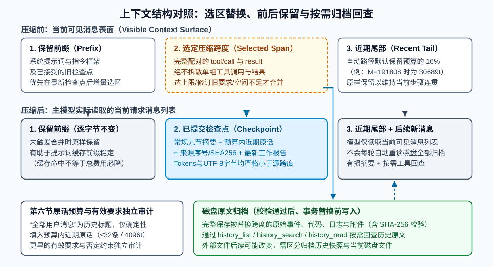
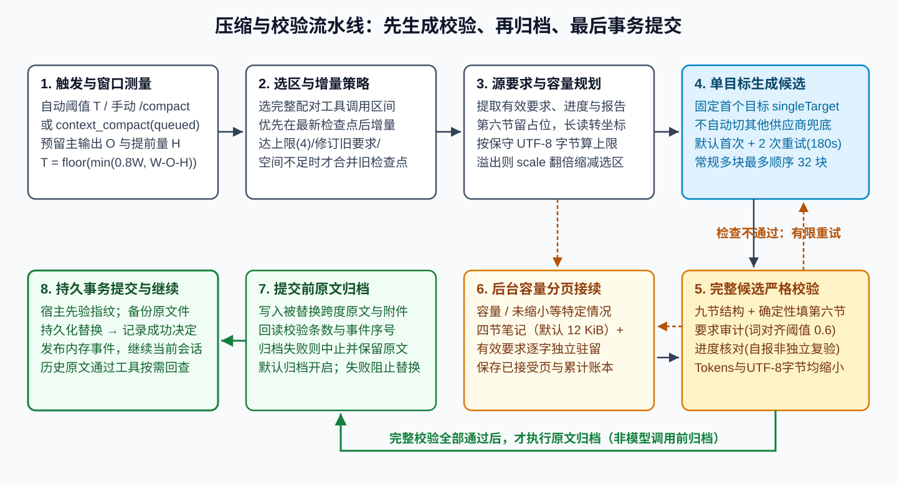
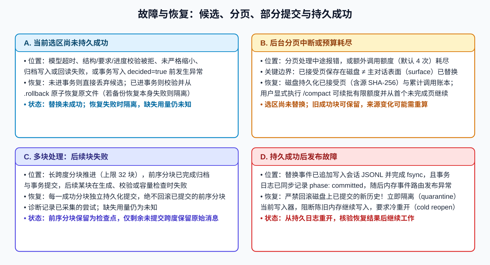

[简体中文](principles.md) · [English](en/principles.md)

# DSH Compaction Weave 工作原理（0.3.2-rc.3）

DSH Compaction Weave 将长对话中较早的历史整理为结构化检查点，保留当前目标、有效要求、已完成进度和下一步动作，并在默认配置下把被替换的原始消息与附件存入本地归档。本文介绍 `0.3.2-rc.3` 的上下文结构、预算公式、执行流水线、校验规则与故障恢复机制。

---

## 1. 核心定位：可见上下文整理与本地归档

在 DeepSeek Harness 中，主模型每一轮推理由宿主组装当前的**可见消息表面**，平时不会自动重读磁盘上的全部历史归档。当对话逐渐增长并接近上下文预算上限时，Weave 从可见历史中选出一段较早且工具调用完整配对的区间，将其折叠为单条结构化**检查点消息**。默认开启归档（`archiveEnabled: true`）时，被折叠的原始事件、长代码片段、工具输出和附件会在替换前写入本地磁盘归档，后续可通过 `history_list`、`history_search` 和 `history_read` 按需检索。

若显式配置 `archiveEnabled: false` 关闭本地归档，压缩时不再写入归档文件，`history_*` 历史检索工具不予注册，后台容量分页接续停用；`context_compact` 阶段收尾工具虽仍按 `proactiveEnabled` 注册，但在调用申请阶段会因缺少归档与检索支撑直接返回 `blocked`。此外，一旦候选选区需要逐出第六节近期原话预算之外的早期用户引文，引文丢失保护也会阻断压缩，防止未归档的用户原话被丢弃。下文各节均按默认开启归档的常规路径阐述。

如上图所示，一次常规压缩提交后，当前可见上下文由三部分组成：

1. **保留前缀（Preserved Prefix）**：包含系统提示词、运行指令框架以及此前已提交的旧检查点。在增量压缩模式下，这部分内容按原字节保留，维持上下文前缀稳定。
2. **检查点（Compact Checkpoint）**：替换选定历史跨度的单条用户侧结构化消息。除模型生成的九节摘要外，引擎还会确定性填入预算内的近期用户原话、来源事件序号与 SHA-256 校验值、有效进度事实，以及该跨度内最新助手工作报告的受限包络。
3. **近期尾部（Preserved Recent Tail）**：对话末尾最近的一段原始交互，在自动路径下默认保留消息预算的 16%，原样留在检查点之后，让主模型自然衔接当前步骤。

---

## 2. 触发机制、窗口数学公式与容量规划

### 2.1 三种触发入口与回执状态

插件支持自动检查、手动命令和模型阶段申请三种触发入口：

| 触发入口 | 触发方式 | 触发条件与默认门限 | 运行结果 |
| :--- | :--- | :--- | :--- |
| **自动压缩（Automatic）** | 主模型请求前的安全步骤自动检查 | `auto: true`，当前输入达到触发线 $T$，且距上次压缩增长满足 `minGrowthTokens`（默认 `0`） | 达到门限时自动执行；若受保留区或单组超大工具消息限制，则跳过或转入后台分页接续 |
| **手动压缩（`/compact`）** | 用户在对话中输入 `/compact` | 独立于自动触发线，直接尝试选择可压缩跨度；若后台分页接续因额外调用额度耗尽而暂停，可续批一轮新额度 | 直接返回本次压缩结果、剩余页进度或具体失败原因 |
| **阶段收尾申请（`context_compact`）** | 模型完成阶段工作后调用工具 | `proactiveEnabled: true`，提供 1–240 字原因，且归档与历史检索工具可用 | 满足申请条件时返回 `status: 'queued'`，待当前工具批次结束后的安全步骤再检查并执行；缺少归档支撑时申请阶段直接返回 `blocked` |

使用阶段申请与手动命令时，有两项关键机制：

- **`queued` 仅表示申请已入队，需以安全步骤后的最终结果为准**：模型调用 `context_compact` 获得 `queued` 时，当前工具批次尚未结束，压缩还未发生。进入下一个安全步骤消费该申请时，若插件已停止则返回 `blocked`；若期间出现新用户输入、会话繁忙、总上下文未达 `proactiveMinTokens`（默认 `8192`）、新增量未达 `proactiveMinGrowthTokens`（默认 `4096`）或无足够可压缩选区，则返回 `skipped`；若轮次已变化可返回 `cancelled`（若执行中触发 `AbortSignal` 则直接中止抛出，未必写入取消回执）。实际进入压缩后，按提交结果与中途报错返回 `compacted`（完成提交）、`partial`（部分提交后中断）或 `failed`（未提交即因校验、保护或请求错误终止）。
- **统一使用 `/compact` 命令**：`0.3.2-rc.2` 已移除旧版独立的 `/context-continue` 命令注册。无论是手动发起压缩，还是在后台分页接续暂停后继续处理剩余页面，均统一使用 `/compact`。

### 2.2 自动触发阈值与 20% 缩减目标公式

配置中的 `thresholdRatio: 0.8` 与主回答预留输出及提前量共同决定实际触发位置。设：

- $W$ 为主会话的安全上下文窗口。首次解析优先采用显式窗口映射，其次读取适配器窗口信息，否则使用至少 `65536` 的配置回退值（默认 `200000`）。会话运行期间独立安全窗口只收紧、不放大，显式可信的小窗口不会被强行抬高到回退下限。
- $O$ 为**下一次主模型回答预留的输出额度**（`reservedCompletionTokens`），它与摘要模型生成检查点时的输出上限（`maxTokens`，默认 `8192`）是两个独立参数。
- $M = W - O$ 为可用于承载消息的预算（`messageBudgetTokens`）。
- $H$ 为有效提前量（`effectiveHeadroom`）：默认取 `headroomTokens = 33000`；若在小窗口下出现 $H \ge M$，则自动收敛为 $\lfloor M \times 0.25 \rfloor$。
- $P = M - H$ 为压力预算（`pressureBudgetTokens`）。

在默认比例参数 `thresholdRatio = 0.8`、`retainRatio = 0.16`、`minimumReductionRatio = 0.2` 下，自动触发线 $T$、未显式指定 `retainTokens` 时的近期尾部保留量 $R$，以及自动压缩的目标总输入 $D$ 按以下公式计算：

$$T = \lfloor \min(W \times 0.8,\ M - H) \rfloor$$

$$R = \lfloor M \times 0.16 \rfloor$$

$$D = \min(T - 1,\ \lfloor \text{currentInput} \times 0.8 \rfloor)$$

通用配置下，上述三式分别对应 $W \times \text{thresholdRatio}$、$M \times \text{retainRatio}$ 与 $\text{currentInput} \times (1 - \text{minimumReductionRatio})$。

**数值演示**：取默认参数 $W = 200000$、下次主回答预留输出 $O = 8192$、`thresholdRatio = 0.8`、`headroomTokens = 33000`、`retainRatio = 0.16`、`minimumReductionRatio = 0.2`：

1. 消息预算：$M = 200000 - 8192 = 191808$ tokens。
2. 有效提前量与压力预算：$H = 33000$ tokens，$P = 191808 - 33000 = 158808$ tokens。
3. 自动触发线：$W \times 0.8 = 160000$，与 $P = 158808$ 取较小值，实际触发线为 $T = 158808$ tokens。
4. 近期尾部保留量：$R = \lfloor 191808 \times 0.16 \rfloor = 30689$ tokens。
5. 自动压缩目标总输入：当 `currentInput = 170000` 超过 $T$ 时，$D = \min(158807,\ \lfloor 170000 \times 0.8 \rfloor) = 136000$ tokens，即本次自动压缩以至少释放 20% 的输入空间为规划目标。

### 2.3 主上下文计量与摘要请求字节预算

插件在主会话与摘要请求两个环节采用不同的计量方式：

- **主会话上下文计量**：优先读取宿主提供的估算值或按历史请求 `usage` 分摊的单条消息成本；缺失时回退到启发式文本估算 `approxTokens`。
- **摘要请求容量规划**：构造发往摘要模型的完整请求（含待压缩源消息、提示词模板、有效要求、工作报告与进度事实）时，将序列化后的每个 **UTF-8 字节** 视为 1 个保守预算单位。设摘要窗口为 $\text{summaryWindow}$、摘要输出上限为 $\text{output}$、安全余量为 $\text{margin} = \min(\text{headroomTokens},\ \lfloor \text{summaryWindow} / 4 \rfloor)$，在默认输入比例 `0.75` 与默认单次字节上限 `458752`（448 KiB，两者均为可配置参数的默认值）下，先对可用窗口做非负收敛，再计算单次摘要请求上限：
  $$\text{Limit} = \left\lfloor \frac{\min(\max(0,\ \text{summaryWindow} - \text{output} - \text{margin}) \times 0.75,\ 458752)}{\text{scale}} \right\rfloor$$
  初始 $\text{scale} = 1$。若服务端仍返回上下文溢出 `CONTEXT_WINDOW_EXCEEDED`，引擎会记录披露的窗口上限并将 $\text{scale}$ 翻倍，使单次允许容量减半后重新选区，保持单条源消息完整而不做正文中途截断。

---

## 3. 选区策略、增量前缀保留与要求生命周期

### 3.1 工具配对平衡与增量检查点策略

选择待压缩跨度时，插件执行两条基本规则：

1. **工具调用与结果成对移动**：任何 `tool/call` 与对应的 `tool/result` 必须同时留在保留区或同时纳入被压缩跨度，避免出现悬空工具消息。
2. **优先在最新检查点之后增量压缩**：默认开启 `cachePreservePrefix: true`。当会话中已有旧检查点时，只要在最新检查点之后能选出工具配对平衡、且预计净释放空间达到 `savingNeeded = max(cacheMinSavingsTokens [默认 4096], 目标释放量)` 的跨度，引擎就原样保留最新检查点及其之前的全部前缀，仅把后续新增历史压缩为新检查点。

仅在以下三种情况下，引擎会将旧检查点一并纳入完整合并：
- 已有检查点数量达到上限 `cacheMaxCheckpoints`（默认 `4` 个）；
- 用户在后续对话中修订（`superseded`）或显式取消（`cancelled`）了早期要求，且被废弃的旧要求位于某个旧检查点内；
- 最新检查点之后的增量跨度扣除新检查点体积后，不足以释放所需的最小空间。

压缩完成后，下一轮主对话保持正常冷读策略，不发送额外的缓存预热请求。

### 3.2 第六节“全部用户消息”与要求独立审计

常规检查点采用固定的九节 Markdown 模板：
1. `用户的核心请求与意图`（`Primary Request and Intent`）
2. `关键技术概念`（`Key Technical Concepts`）
3. `涉及的文件与代码`（`Files and Code Sections`）
4. `错误与修复`（`Errors and Fixes`）
5. `问题解决过程`（`Problem Solving`）
6. `全部用户消息`（`All User Messages`）
7. `待办任务`（`Pending Tasks`）
8. `已完成的工作`（`Work Completed`）
9. `继续工作所需的上下文`（`Context for Continuing Work`）

模型生成九节摘要正文时的软性长度目标为 `4000` 字符，用于引导精炼表述，同时要求保留完整事实与约束。

其中第六节沿用了历史模板标题 **“## 6. 全部用户消息”（`## 6. All User Messages`）**，其实际填充机制与保留尾部 $R$ 及早期要求审计明确分工：

- **近期原话预算确定性填充**：摘要模型在第六节只需输出占位符 `[由引擎填充]` 或 `[filled by engine]`。模型返回后，引擎按原始时间顺序将**预算内选定的近期用户原话**（默认最多 `preserveRecentMessages: 32` 条、累计不超过 `preserveRecentUserTokens: 4096` 估算 tokens）逐字填入第六节。纯催促类短消息（如“继续”“好的”）不占用引文预算；预算吃紧时优先淘汰最早的完整引文。该引文预算与第 2.2 节的对话末尾保留尾部 $R$ 彼此独立。
- **早期有效要求独立追踪**：默认开启归档时，滑出第六节近期引文预算的更早用户原话完整保存在磁盘归档中。同时，记忆选择器按事件序号追踪每条用户要求的生命周期，包括生效、修订覆盖、显式取消、作用对象与环境范围。只要早期要求未被取消或覆盖，仍作为**有效要求**参与压缩后的独立要求审计；在后台分页接续模式下则逐字保存在 `## Preserved source requirements` 专节。已被用户显式取消的要求及其取消指令会被剔除，防止废弃约束重新进入检查点（`RETIRED_MEMORY_REINTRODUCED`）。

---

## 4. 执行流水线、单目标路由与后台分页接续

### 4.1 常规压缩的五步流水线

默认配置下，常规压缩严格按“先生成并完整校验候选，再写入原文归档，最后持久提交替换”的顺序执行：

1. **选区与源数据提取**：确定工具配对平衡跨度，提取有效要求、预算内近期原话、进度事实与跨度内最新助手工作报告。
2. **生成候选摘要**：向解析出的摘要目标发起请求，获取九节摘要候选。
3. **内存完整校验**：填入第六节近期原话并组装完整检查点块，依次执行九节结构校验、废弃要求复燃检查、原话覆盖核对、估算 tokens 与规范化 UTF-8 字节双重严格缩小检查、进度事实核对与要求审计（含必要的确定性要求行重建）。
4. **写入并校验原文归档**：全部校验通过后，将选定跨度的原始事件与附件写入本地归档，并按需回读核对条数与事件序号。
5. **持久化事务提交与发布**：归档确认完成后，执行带 `.rollback` 备份与事务日志的持久化替换，并更新内存会话表面。

若候选生成、审计校验或归档写入失败，流程立即中止，主会话可见历史保持原状。

### 4.2 单目标路由与有限重试

摘要目标按以下优先级解析：（1）显式配置的 `summarizationProvider` 与 `summarizationModel`；（2）当前会话已持久化的模型路由；（3）当前代理声明的模型路由。仅当摘要目标与主对话路由的 `provider/model` 完全一致时，才复用 `reasoningEffort`、`temperature`、`stop` 等采样参数，避免跨模型参数不兼容。

实际请求固定使用 `singleTarget: true`，即**只向解析出的第一个摘要目标发起调用，不在失败时自动跨供应商或跨模型兜底切换**。每个候选摘要或接续分页默认拥有 **1 次初始请求 + 最多 2 次重试**（`summaryRetryCount: 2`，共 3 次尝试），单次超时 `summaryTimeoutMs = 180000`（180 秒），重试间隔按 `1s`、`2s` 指数退避，上限 `30s`。网络可重试错误与校验失败触发的带反馈重生成共用这一重试额度；收到取消信号 `AbortSignal` 时立即终止。

### 4.3 常规分块提交与后台分页接续

针对大跨度历史，插件区分常规顺序分块与后台容量分页接续两种模式：

| 对比维度 | 常规分块压缩（Bounded Chunks） | 后台容量分页接续（Backend Continuation） |
| :--- | :--- | :--- |
| **触发条件** | 常规选区按可接受分块顺序推进，上限 `maxSummaryChunks: 32` | 常规压缩遇到容量或体积类拒绝（`SUMMARY_NOT_SMALLER`、`SUMMARY_GROUP_TOO_LARGE`、`SUMMARY_BATCH_LIMIT`、`COMPACTION_CAPACITY_BLOCKED` 或全部子项属于上述代码的 `SUMMARY_ALL_FAILED`），且归档与历史检索工具可用 |
| **输出结构** | 九节完整检查点 + 第六节近期原话 | 四节工作笔记（`Goal`、`State`、`Next`、`Uncertain`）+ 逐字保留的 `## Preserved source requirements` |
| **体积上限** | 完整检查点严格小于被替换跨度的估算 tokens 与规范化 UTF-8 字节 | 工作笔记上限 `continuationMemoryBytes: 12288` B（12 KiB），整份替换上限 `continuationMaxBytes: 98304` B（96 KiB），最多 32 页 |
| **提交时机** | **逐块提交**：每块通过校验并归档后立即替换对应跨度 | **全页完成后提交**：分页期间将已接受页与调用账本保存在磁盘，全部页面完成并通过整份校验后才替换主历史 |

---

## 5. 严格缩小检查、要求审计与进度核对

### 5.1 完整检查点的双重严格缩小检查

引擎在拼装出完整检查点块（含摘要正文、第六节近期原话、最新工作报告包络与进度事实）后，执行双重严格不等式检查：

1. **估算 Tokens 严格缩小**：`checkpointTokens < shadowedTokenCount`；
2. **规范化 UTF-8 字节严格缩小**：`checkpointCanonicalBytes < shadowedCanonicalBytes`。

任一指标大于或等于被替换跨度时，候选即被判定为 `SUMMARY_NOT_SMALLER` 并拒绝提交，防止附加原话或元数据后反而放大上下文。

### 5.2 要求审计、进度核对与确定性行重建

- **要求审计（Requirement Audit）**：核对全部有效用户要求在候选检查点中的词汇对齐覆盖率、精确数字、否定极性（如“禁止”“不要”未被写成肯定句）、前提条件与作用对象范围。默认 `auditCoverageThreshold: 0.6` 是单条约束行的**词汇对齐判定阈值**，用于判断摘要语句是否与源要求对应，而非整篇摘要的质量打分。默认开启 `auditBlockOnLoss: true`，发现极性翻转 `CONSTRAINT_POLARITY_LOST` 或有效约束缺失 `CONSTRAINT_LOST` 时直接阻断提交。
- **进度事实核对（Progress Validation）**：独立提取源跨度内的可量化计数、同批次作用对象、产物路径与完成状态以及下一步动作，发现与最新来源状态矛盾时返回 `PROGRESS_FACT_CONFLICT`。同时，引擎会提取跨度内最新助手工作报告 `work-report`（上限 `3072` 字节，附事件序号与 SHA-256；超长或被后续同范围进度覆盖时转为来源坐标说明）供后续参考。
- **确定性要求行重建**：当候选摘要仅因要求审计未通过且无 `PROGRESS_FACT_CONFLICT` 时，引擎可基于源用户消息在本地确定性补齐有争议的约束行，最多迭代 8 轮、移除行指纹不超过 16 个、总字节增长不超过 `8192` B，随后将重建稿作为新候选从头执行完整结构、进度和双重体积缩小校验。
- **外部读取坐标投影**：构造摘要请求输入时，技能目录 `skill-catalog`、运行时上下文 `runtime-context` 及文件或网页读取结果（`read`、`read_file`、`ops_read_files`、`read_page`、`memory_get`、`skill`）会投影为精简的检索坐标提示，避免长文件内容占满摘要窗口；原始完整内容仍保存在磁盘归档中。

---

## 6. 事务保护与四类故障恢复边界

故障发生的位置决定了上下文与磁盘状态的处理方式，其中事务日志是否已写入持久提交决定是核心分界线：

1. **阶段 A：未进入提交或持久成功决定前失败**
   - 模型超时、校验拒绝或归档写入失败时，表面替换尚未启动，原消息列表保持不变。
   - 进入事务提交流程后，引擎先核验已审查的宿主存储方法指纹（覆盖 `DSH 0.2.2-rc.1`、`0.2.2-rc.2` 与 `0.2.2-rc.3`，其中 `rc.2`/`rc.3` 适配了新增批量输入与辅助校验拆分的 `Session.append` 实现），将会话 JSONL 同步复制并 `fsync` 为 `.rollback` 备份，写入 `.tail` 及事务日志 `phase: 'committing'`。只要在写入 `phase: 'committed'`（即持久成功决定 `decided = true`）前发生异常或取消，引擎即从 `.rollback` 原子恢复原会话文件；若恢复操作本身失败，则保留恢复材料并隔离该会话的后续写入。
2. **阶段 B：后台分页接续中断或额外调用预算耗尽**
   - 后台接续每完成一页校验，都会将该页源文本 SHA-256、最新四节工作笔记及调用耗时与 `usage` 持久化到 `continuation-progress`。
   - 若中途报错或额外调用预算（默认 `continuationMaxExtraCalls: 4`）耗尽，已接受页保留在磁盘，主会话历史暂不替换。用户随后输入 `/compact` 时，若源消息与关键配置未变，可获批新一轮有限额度并从首个未完成页继续；若源消息已变动则重新计算分页，同时在累计账本中保留历史调用记录。
3. **阶段 C：常规多块顺序压缩的后块失败（`partial`）**
   - 常规分块压缩最多推进 `32` 块，逐块完成归档与事务提交。若前几块已成功提交而后续某块失败，已提交分块保留为检查点，失败分块保留原始消息，最终状态返回 `partial`。
4. **阶段 D：磁盘持久提交成功后内存表面发布失败**
   - 一旦事务日志写入 `phase: 'committed'`，磁盘上的新会话文件已成为权威状态。若随后的内存会话发布报错 `COMPACTION_SURFACE_PUBLISH_FAILED`，引擎不会把磁盘回滚到旧文件，而是立即隔离当前内存会话的后续写入并重开会话，从已提交的磁盘状态重新加载。

---

## 7. 风险与适用范围

为便于评估插件在具体工作流中的表现，以下集中列出质量、容量、恢复与费用的适用边界：

- **有损摘要与语义识别边界**：检查点本质是受审计约束的有损摘要加按需归档回查。`0.3.2-rc.2` 修复了已复现的历史快照取代和协调否定范围误判，但自然语言表达多样，复杂的中文间接否定（如“并非……”“不是……而是已被取代”）及跨句隐式指代仍可能触发误拒或漏检。检查点中的助手 `work-report` 代表带来源序号的历史助手报告，不等同于外部环境的独立复验；回查文件时也需区分归档中的历史读取快照与磁盘上的当前最新文件。
- **容量目标与分词计量边界**：默认的 20% 最小缩减幅度（`minimumReductionRatio: 0.2`）是自动压缩的规划目标。当系统提示词、近期保留尾部 $R$ 或不可拆分的单组超大工具调用占满窗口时，单次压缩可能无法释放 20% 空间，此时会跳过或转入后台接续。主上下文估算与摘要请求的 UTF-8 字节预算均为保守工程计量，并非模型供应商底层的精确分词器。
- **宿主兼容范围与私有方法指纹边界**：插件声明兼容 `dsh >=0.2.2-rc.1 <0.3.0-0`（覆盖 `0.2.2-rc.1` 起的 `0.2` 预发布版与正式版，不含 `0.3.0` 预发布版），并已在 `DSH 0.2.2-rc.1`、`0.2.2-rc.2` 与 `0.2.2-rc.3` 上完成真实宿主事务验证（见 [benchmarks/rc3-host-compatibility.json](benchmarks/rc3-host-compatibility.json)）。后续 `0.2.x` 版本即使通过安装器版本范围检查，若其私有写入或发布方法指纹不在已核验白名单内，引擎仍会在发起摘要请求或修改可见历史前拒绝压缩，并保留既有恢复材料。
- **多块提交与故障恢复边界**：后台分页接续在全部页面完成前不会替换主历史；常规多块压缩若中途失败会停留在已落盘分块的 `partial` 状态；磁盘持久提交后的内存发布失败可通过重新打开会话对齐磁盘状态；若 `.rollback` 原子恢复本身失败，会话写入会被隔离并保留现场恢复文件供排查。
- **Token 缩减与实际 API 费用边界**：减少单次输入 tokens 与总账单变化受不同因素支配。总费用同时取决于摘要请求本身、校验重生成、压缩后首答对缓存前缀的影响以及供应商计费结构。多模型配对实验条件、GLM 代理单价情景估算与详细费用表见 [测试记录](testing.md)。

---

## 8. 代码与证据导航

深入实现细节可结合 [代码导航](architecture.md)、[配置指南](configuration.md)、[测试记录](testing.md)、[故障排查](troubleshooting.md) 与 [提交问题与日志脱敏](feedback.md) 查阅以下核心模块（每个源文件仅链接一次）：

- 插件入口、命令与工具注册：[../lib/index.js](../lib/index.js)
- 配置解析与窗口触发预算公式：[../lib/config.js](../lib/config.js)、[../lib/window.js](../lib/window.js)
- 压缩主流水线与分块调度：[../lib/engine.js](../lib/engine.js)
- 缓存前缀保留策略与工具平衡跨度选区：[../lib/cache-policy.js](../lib/cache-policy.js)、[../lib/region.js](../lib/region.js)
- 用户要求生命周期追踪与第六节近期原话选择：[../lib/memory-policy.js](../lib/memory-policy.js)
- 要求对齐审计、进度事实核对与确定性行重建：[../lib/audit.js](../lib/audit.js)、[../lib/progress-facts.js](../lib/progress-facts.js)、[../lib/reconstruct.js](../lib/reconstruct.js)
- 后台容量分页接续与持久化进度账本：[../lib/continuation.js](../lib/continuation.js)、[../lib/continuation-progress.js](../lib/continuation-progress.js)
- 本地历史消息归档检索与附件存储：[../lib/history.js](../lib/history.js)、[../lib/attachments.js](../lib/attachments.js)
- 会话持久化事务提交与原子替换恢复：[../lib/transaction.js](../lib/transaction.js)、[../lib/atomic-replace.js](../lib/atomic-replace.js)
- 失败诊断元数据白名单与审计拒绝记录：[../lib/failure-diagnostics.js](../lib/failure-diagnostics.js)、[../lib/audit-reject.js](../lib/audit-reject.js)
