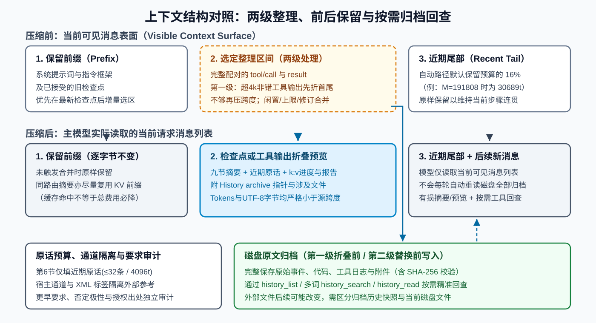
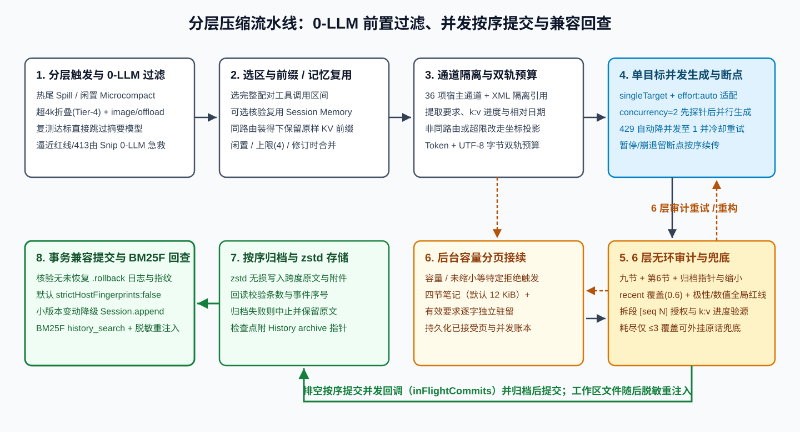
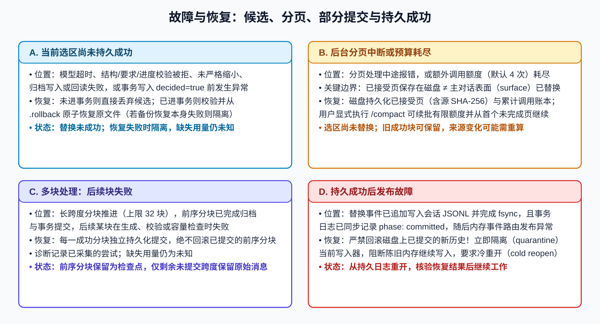

[简体中文](principles.md) · [English](en/principles.md)

# DSH Compaction Weave 工作原理（0.3.2）

DSH Compaction Weave 用来解决长对话“越聊越长、旧要求容易忘、工具日志撑爆窗口”的问题。它会把较早的对话整理成结构化**检查点**，保留当前目标、有效要求、已完成进度和下一步动作，并在默认配置下先把被替换的原始消息与附件写入本地归档，方便模型在需要核对细节时按需回查。本文用通俗方式介绍 `0.3.2` 的两级整理思路、预算公式、来源隔离、校验规则与故障恢复边界。

---

## 1. 核心定位：两级整理可见上下文与本地归档

在 DeepSeek Harness（DSH）中，主模型每一轮推理由宿主拼装当前的**可见消息表面**，平时不会自动把磁盘上的历史归档全量读进上下文。随着文件读取、终端日志和旧轮次不断累积，可见消息会逐步逼近模型窗口上限。在默认开启本地归档（`archiveEnabled: true`）时，Weave 采用**“先轻折工具输出、不够再总结对话”**的两级策略：

1. **第一级：零模型调用的工具输出归档折叠（`observationMaskingEnabled: true`）**
   - 对话膨胀很多时候不是聊了多少句，而是几次读文件、跑测试留下了几万字的工具返回。在**没有挂起后台分页接续、且本地归档与 `history_*` 工具均可用**的前提下，引擎会扫描保留近期尾部之外、超过 `observationMaskThresholdChars`（默认 `4000` 字符）的非报错工具结果（`tool/result`），先把完整原文写入本地归档，再把可见列表里的那条工具结果替换为**“开头 300 字 + 结尾 300 字预览”**（`observationMaskHeadChars` / `observationMaskTailChars`）以及一行 `history_read` 回查指引，让模型依然看得见报错摘要和关键轮廓。
   - **什么时候直接跳过总结模型**：在常规自动压力检查（`pressure`）时，引擎先凭估算节省量判断是否值得启动第一级；提交第一级后会**重新实测可见上下文大小**，只有实测总输入同时低于触发线 $T$ 且达到本次缩减目标（`<= initialReductionTarget`）时，才直接结束本轮并省掉摘要模型调用——避免刚改动前缀紧接着又发起摘要、打断提示词缓存；而在已经触发上下文溢出（`context-overflow`）时，会在宿主自带工具裁剪前优先把完整原件归档并折叠。报错工具结果和非文本内容块默认原样保留；若某条工具结果的历史来源链深度已达 `63` 层或单批依赖引用数超过 `3840` 条，则自动跳过以保护后续归档溯源。
2. **第二级：结构化检查点摘要**
   - 当第一级无法单独释放足够空间，或进入手动 `/compact`、模型主动申请 `context_compact`、闲置后恢复压缩时，Weave 从可见历史中选出一段工具调用完整配对的区间，调用摘要模型把它折叠为单条结构化**检查点消息**。被折叠的原始事件、长代码片段、工具输出和附件会在替换前完整写入本地磁盘归档，后续可通过 `history_list`、`history_search` 和 `history_read` 按需检索。

若显式配置 `archiveEnabled: false` 关闭本地归档：第一级工具折叠、磁盘归档写入、`history_*` 历史检索工具与后台容量分页接续都会停用；`context_compact` 阶段收尾工具虽仍按 `proactiveEnabled` 注册，但在调用申请阶段会因缺少归档支撑直接返回 `blocked`。此外，一旦候选选区需要逐出检查点第 6 节（“全部用户消息”）近期原话预算之外的早期用户引文，引文丢失保护也会阻断压缩，防止未归档的用户原话被丢弃。下文各节均按默认开启归档的常规路径阐述。

如上图所示，一次常规检查点压缩提交后，当前可见上下文由三部分组成：

1. **保留前缀（Preserved Prefix）**：包含系统提示词、运行指令框架以及此前已提交的旧检查点。在增量压缩模式下，这部分内容按原字节保留，维持上下文前缀稳定。
2. **检查点（Compact Checkpoint）**：替换选定历史跨度的单条用户侧结构化消息。除模型生成的九节摘要外，引擎还会确定性填入预算内的近期用户原话、来源事件序号与 SHA-256 校验值、结构化进度事实、该跨度内最新助手工作报告（不超过 `3072` 字节且未被同作用域新进度取代时附原文与来源序号，否则改为来源序号提示，并在检查点元数据里登记 SHA-256 校验值），以及一行归档定位指针（`History archive: <compactionId> (seq start-end)`，并附最多 `8` 个涉及的文件路径 `Archived files: ...`），方便主模型直接用 `history_search` / `history_read` 回查而不必先枚举全部归档；无论跨度长短，只要附上完整指针会导致检查点未能严格缩小（估算 tokens 或规范化 UTF-8 字节未低于源跨度），引擎就会先去掉涉及文件列表、再省略指针行本身。
3. **近期尾部（Preserved Recent Tail）**：对话末尾最近的一段原始交互，在自动路径下默认保留消息预算的 16%，原样留在检查点之后，让主模型自然衔接当前步骤。

---

## 2. 触发机制、窗口数学公式与容量规划

### 2.1 四种触发入口与回执状态

插件支持自动压力检查、闲置后先压缩、手动命令和模型阶段申请四种触发入口：

| 触发入口 | 触发方式 | 触发条件与默认门限 | 运行结果 |
| :--- | :--- | :--- | :--- |
| **自动压缩（Automatic）** | 主模型请求前的安全步骤自动检查 | `auto: true`，当前输入达到触发线 $T$，且距上次压缩增长满足 `minGrowthTokens`（默认 `0`） | 先检查第一级工具输出折叠能否达标；不够再选区生成检查点，受保留区或超大工具组限制时跳过或转入后台分页接续 |
| **闲置后先压缩（`idleCompactionMinutes`）** | 长时间未活动后新用户回合开始的第一步 | 独立于 `auto`，默认 `0`（关闭），支持 `1–43200` 整数分钟（最长 30 天）；仅当**最近一次用户/助手/工具实际活动**至新消息最初入队时间超过该阈值，且上下文不低于 `idleCompactionMinTokens`（默认 `0`；若已有未完成的挂起分页接续则跳过该下限直接恢复）时触发 | 由于服务商缓存多半已过期，会关闭增量前缀复用（`cachePreservePrefix: false`）集中合并冷历史：常规跨度按 `idleRetainTokens`（默认 `0`）保留末尾，接续路径沿用接续选区；小历史直接跳过，失败或取消时原样退回队列里的用户输入 |
| **手动压缩（`/compact`）** | 用户在对话中输入 `/compact` | 独立于自动触发线，直接尝试选择可压缩跨度；若后台分页接续因额外调用额度耗尽而暂停，可续批一轮新额度 | 直接返回本次压缩结果、剩余页进度或具体失败原因 |
| **阶段收尾申请（`context_compact`）** | 模型完成阶段工作后调用工具 | `proactiveEnabled: true`，提供 1–240 字原因，且归档与历史检索工具可用 | 满足申请条件时返回 `status: 'queued'`，待当前工具批次结束后的安全步骤再检查并执行；缺少归档支撑时申请阶段直接返回 `blocked` |

使用阶段申请、闲置压缩与手动命令时，还有几项关键边界需要了解：

- **`queued` 仅表示申请已入队，需以安全步骤后的最终结果为准**：模型调用 `context_compact` 获得 `queued` 时，当前工具批次尚未结束，压缩还未发生。进入下一个安全步骤消费该申请时，若插件已停止则返回 `blocked`；若期间出现新用户输入、会话繁忙、总上下文未达 `proactiveMinTokens`（默认 `8192`）、新增量未达 `proactiveMinGrowthTokens`（默认 `4096`）或无足够可压缩选区，则返回 `skipped`；若轮次已变化可返回 `cancelled`（若执行中触发 `AbortSignal` 则直接中止抛出，未必写入取消回执）。实际进入压缩后，按提交结果与中途报错返回 `compacted`（完成提交）、`partial`（部分提交后中断）或 `failed`（未提交即因校验、保护或请求错误终止）。
- **闲置触发不依赖外部计时器或服务商缓存声明**：插件通过会话日志里的持久化时间戳判断实际闲置时长（未知时间、系统启动事件或活跃工具循环中途都不触发）；若设置页面选择了 `30 分钟`，它仅作为插件何时发起整理的操作门限，不保证或修改上游模型服务商的真实缓存有效期。
- **统一使用 `/compact` 命令**：`0.3.2-rc.2` 起已移除旧版独立的 `/context-continue` 命令注册。无论是手动发起压缩，还是在后台分页接续暂停后继续处理剩余页面，均统一使用 `/compact`。

### 2.2 自动触发阈值与 20% 缩减目标公式

配置中的 `thresholdRatio: 0.8` 与主回答预留输出及提前量共同决定实际触发位置。设：

- $W$ 为主会话的安全上下文窗口。首次解析优先采用显式窗口映射，其次读取适配器窗口信息，否则使用至少 `65536` 的配置回退值（默认 `200000`）。会话运行期间独立安全窗口只收紧、不放大，显式可信的小窗口不会被强行抬高到回退下限。
- $O$ 为**下一次主模型回答预留的输出额度**（`reservedCompletionTokens`），它与摘要模型生成检查点时的输出上限（`maxTokens`，默认 `8192`）是两个独立参数。
- $M = W - O$ 为可用于承载消息的预算（`messageBudgetTokens`）。
- $H$ 为有效提前量（`effectiveHeadroom`）：取 $\min(\text{headroomTokens},\ \lfloor M \times 0.30 \rfloor)$，默认 `headroomTokens = 33000`。连续的 30% 上限避免窗口增大时触发线突然下降；按比例保留尾部且触发比例允许时，还会进一步缩小 $H$，确保 $R$ 与触发线之间至少留出 1 token。
- $P = M - H$ 为压力预算（`pressureBudgetTokens`）。

在默认比例参数 `thresholdRatio = 0.8`、`retainRatio = 0.16`、`minimumReductionRatio = 0.2` 下，自动触发线 $T$、未显式指定 `retainTokens` 时的近期尾部保留量 $R$，以及自动压缩的目标总输入 $D$ 按以下公式计算：

$$T = \lfloor \min(W \times 0.8,\ M - H) \rfloor$$

$$R = \lfloor M \times 0.16 \rfloor$$

$$D = \min(T - 1,\ \lfloor \text{currentInput} \times 0.8 \rfloor)$$

通用配置下，上述三式分别对应 $W \times \text{thresholdRatio}$、$M \times \text{retainRatio}$ 与 $\text{currentInput} \times (1 - \text{minimumReductionRatio})$。

**数值演示**：取默认参数 $W = 200000$、下次主回答预留输出 $O = 8192$、`thresholdRatio = 0.8`、`headroomTokens = 33000`、`retainRatio = 0.16`、`minimumReductionRatio = 0.2`：

1. 消息预算：$M = 200000 - 8192 = 191808$ tokens。
2. 有效提前量与压力预算：$H = 33000$ tokens，$P = 191808 - 33000 = 158808$ tokens。
3. 自动触发线：$W \times 0.8 = 160000$，与 $P = 158808$ 取较小值，实际触发线为 $T = 158808$ tokens。
4. 近期尾部保留量：$R = \lfloor 191808 \times 0.16 \rfloor = 30689$ tokens。
5. 自动压缩目标总输入：当 `currentInput = 170000` 超过 $T$ 时，$D = \min(158807,\ \lfloor 170000 \times 0.8 \rfloor) = 136000$ tokens，即本次自动压缩以至少释放 20% 的输入空间为规划目标。

### 2.3 主上下文计量、同路由前缀复用与摘要字节预算

插件在主会话与摘要请求两个环节采用不同的计量方式，并尽可能复用已有提示词缓存：

- **主会话上下文计量**：优先读取宿主提供的估算值或按历史请求 `usage` 分摊的单条消息成本；缺失时回退到启发式文本估算 `approxTokens`。
- **常驻工具定义开销**：启用历史工具和主动压缩时，`history_list`、`history_read`、`history_search`、`context_compact` 四个定义的序列化 JSON 合计 **2,563 字符 / 645 DSH tokens / 约 697 BPE tokens**；BPE 数量随分词器而异。配置入口为 **设置 → 上下文压缩（Weave）**，或插件详情页。
- **同模型路由原样前缀复用（`preservePrefixCache`）**：在常规压缩的**首次尝试**（非闲置模式、非后台分页模式）中，如果解析出的主摘要目标（`provider/model`）与当前会话**已持久化的模型路由**完全一致，且把“系统消息 + 保留前缀 + 待压缩区间”原样一字节不改地发送也装得进预算上限（包含宿主按节点计价的图片/音频等多模态开销），Weave 就会保持前缀原封不动，仅在请求末尾追加渠道标记与“只总结增量区间、不要复述前缀”的说明。这样摘要请求有更大机会直接命中服务商侧已经算好的 KV 缓存，避免把长前缀重算一遍。
- **摘要请求容量规划与降级回退**：跨模型摘要、原文装不下上限或开启外部投影重选时，系统会把大段技能目录、运行上下文和文件/网页读取输出折算为简短坐标提示，并采用**双轨同量纲预算**同时约束 Token 与 UTF-8 字节体积：Token 轨对完整摘要请求做保守分语种估算（CJK 按 `summaryCjkTokensPerChar` 默认 `0.75` tok/字、ASCII 按 `0.25` tok/字符、其余非 ASCII 按 `0.5` tok/字符，另加结构头开销；实际计费与硬上限以目标模型分词器为准，需要兼容较碎 CJK 分词器时可在设置中调至 `1.0`），UTF-8 字节轨独立校验序列化总字节数。设摘要窗口为 $\text{summaryWindow}$、摘要输出上限为 $\text{output}$、安全余量为 $\text{margin} = \min(\text{headroomTokens},\ \lfloor \text{summaryWindow} / 4 \rfloor)$，在默认输入比例 `0.85` 与默认单次字节上限 `2097152`（2 MiB，两者均为可配置参数的默认值）下，先对可用窗口做非负收敛，再分别计算 Token 上限与字节上限：
  $$\text{TokenLimit} = \left\lfloor \frac{\max(0,\ \text{summaryWindow} - \text{output} - \text{margin}) \times 0.85}{\text{scale}} \right\rfloor,\quad \text{ByteLimit} = \left\lfloor \frac{2097152}{\text{scale}} \right\rfloor$$
  初始 $\text{scale} = 1$。容量规划器在筛选区间时只用**不含强制归档指针**的最简检查点体积来判断是否有缩小可能（防止紧凑区间在真正执行指针精简前被误拒）。如果服务端仍返回 `CONTEXT_WINDOW_EXCEEDED`：重选逻辑会把允许上限收紧为**现有缩减上限与上次实测输入单位数一半**里的较小值，并关闭原文前缀模式——若此前是原文前缀触发超限，只要退回紧凑投影后同一跨度确实能把输入单位降下来并装进新上限，就优先在同一区间上降级重摘要；否则缩短区间端点并随溢出观测将 $\text{scale}$ 翻倍，始终保持单条源消息完整而不做正文中途截断。

---

## 3. 选区策略、来源通道隔离与要求生命周期

### 3.1 工具配对平衡与增量检查点策略

选择待压缩跨度时，插件执行两条基本规则：

1. **工具调用与结果成对移动**：任何 `tool/call` 与对应的 `tool/result` 必须同时留在保留区或同时纳入被压缩跨度，避免出现悬空工具消息。
2. **优先在最新检查点之后增量压缩**：默认开启 `cachePreservePrefix: true`。当会话中已有旧检查点时，只要在最新检查点之后能选出工具配对平衡、且预计净释放空间达到 `savingNeeded = max(cacheMinSavingsTokens [默认 4096], 目标释放量)` 的跨度，引擎就原样保留最新检查点及其之前的全部前缀，仅把后续新增历史压缩为新检查点。

仅在以下情况之一成立时，引擎才会将旧检查点一并纳入完整合并：
- 闲置恢复压缩主动将 `cachePreservePrefix` 设为 `false`，集中合并冷对话历史；
- 已有检查点数量达到上限 `cacheMaxCheckpoints`（默认 `4` 个）；
- 用户在后续对话中修订（`superseded`）或显式取消（`cancelled`）了早期要求，且被废弃的旧要求位于某个旧检查点内；
- 最新检查点之后的增量跨度扣除新检查点体积后，不足以释放所需的最小空间。

压缩完成后，下一轮主对话直接按正常方式发送请求（不再额外发起缓存预热请求），由服务端自行匹配前缀。

### 3.2 第六节“全部用户消息”、来源通道隔离与早期要求追踪

常规检查点采用固定的九节 Markdown 模板：
1. `用户的核心请求与意图`（`Primary Request and Intent`）
2. `关键技术概念`（`Key Technical Concepts`）
3. `涉及的文件与代码`（`Files and Code Sections`）
4. `错误与修复`（`Errors and Fixes`）
5. `问题解决过程`（`Problem Solving`）
6. `全部用户消息`（`All User Messages`）
7. `待办任务`（`Pending Tasks`）
8. `已完成的工作`（`Work Completed`）
9. `继续工作所需的上下文`（`Context for Continuing Work`）

模型生成九节摘要正文时的软性长度目标为 `4000` 字符，用于引导精炼表述，同时要求保留完整事实与约束。

其中第六节沿用了历史模板标题 **“## 6. 全部用户消息”（`## 6. All User Messages`）**，与保留尾部 $R$、来源通道隔离及早期要求审计协同分工：

- **近期原话预算确定性填充**：摘要模型在第六节只需输出占位符 `[由引擎填充]` 或 `[filled by engine]`。模型返回后，引擎按原始时间顺序将**预算内选定的近期用户原话**（默认最多 `preserveRecentMessages: 32` 条、累计不超过 `preserveRecentUserTokens: 4096` 估算 tokens）逐字填入第六节。纯催促类短消息（如“继续”“好的”）不占用引文预算；预算吃紧时优先淘汰最早的完整引文。该引文预算与第 2.2 节的对话末尾保留尾部 $R$ 彼此独立。
- **区分真实用户指令与外部参考内容（宿主通道 + 显式标签边界）**：网页正文、技能说明、工具返回或用户转发的引用里经常出现“请删除……”“用户已批准……”这类带有命令语气的句子，如果靠启发式自然语言正则去猜“这句话是不是用户下的命令”，既容易漏掉也容易误杀正常表达。`0.3.2` 改为完全依据**结构边界**区分来源：
  - 凡是来自宿主非用户输入通道的事件——包括工具结果 `tool/result` 以及已知的运行时/上下文参照类型（`runtime-context`、`session-reference`、`skill-catalog`、`agent-message`、`subagent-settled`、`tool-jobs`、`time-context`、`msg-state`、`weave-compaction-status`）——统一视为外部参考，不进入有效用户指令集合。发送到投影摘要请求或接续分页时，用 `<untrusted_reference seq="..." kind="...">...</untrusted_reference>` 显式包起来，转义正文和参数中混入的同名边界标签；同路由原样前缀模式则在请求末尾附上 `<channel-provenance>` 清单标明各条消息来源；多页长消息页头也附带 `channel=untrusted_reference` 标识。
  - 在**真实 `user/message` 消息内部**，如果用户引用了他人话语或示例文本，使用 `<untrusted_reference>`、`<quoted_text>`、`<untrusted_text>`、`<reference>`、`<blockquote>` 等显式标签包起引用片段（支持同类嵌套、支持跨行标签属性与引号内斜杠，且遇到嵌套错位或未闭合标签时直接保守地将到本条消息末尾的内容全视为引用），标签外才视为真实用户指令。
- **早期有效要求独立追踪**：默认开启归档时，滑出第六节近期引文预算的更早用户原话完整保存在磁盘归档中。同时，记忆选择器按事件序号追踪每条用户要求的生命周期，包括生效、修订覆盖、显式取消（包含英文条件保护如 `"cancel that, if approved"` 不会被误拆成无条件取消，以及跳过无约束词的纯闲聊语句）、作用对象与环境范围。只要早期要求未被取消或覆盖，仍作为**有效要求**参与压缩后的独立要求审计；在后台分页接续模式下则逐字保存在 `## Preserved source requirements` 专节。已被用户显式取消的要求及其取消指令会被剔除，防止废弃约束重新进入检查点（`RETIRED_MEMORY_REINTRODUCED`）。

---

## 4. 执行流水线、单目标路由与后台分页接续

### 4.1 两级检查与常规五步压缩流水线

默认配置下，插件在安全步骤先评估零模型开销的第一级工具输出折叠，再按“先生成并完整校验候选，再写入原文归档，最后持久提交替换”的五步顺序执行第二级检查点压缩：

- **前置检查（第一级，仅开启归档、`history_*` 工具可用、未启用后台分页接续且 `observationMaskingEnabled` 为开启时执行）**：扫描近期尾部之外达到字符阈值且非报错的工具输出。在 `pressure` 触发下，当估算节省量足以达到初始缩减目标时先写入归档并替换表面，随后重新实测，仅当总输入同时低于阈值 $T$ 且达到目标上限时才直接结束本轮；在 `context-overflow` 触发下则先做一轮归档折叠，避免宿主自带裁剪丢弃原文。如果此时仍高于触发阈值或通过 `/compact`、`context_compact`、闲置恢复触发，则继续下面五步生成检查点：
  1. **选区、通道隔离与源数据提取**：确定工具配对平衡跨度，基于宿主通道和显式 XML 引用标签区分真实用户指令与外部参考，提取有效要求、预算内近期原话、结构化进度事实与跨度内最新助手工作报告。
  2. **生成候选摘要**：向解析出的摘要目标发起请求，获取九节摘要候选（同路由且装得下时原样保留前缀以利缓存命中，否则使用外部读取坐标投影并附 `<untrusted_reference>`）。
  3. **内存完整校验**：填入第六节近期原话并组装完整检查点块（视体积保留或精简 `History archive` 归档指针），依次执行九节结构校验、废弃要求复燃检查、原话覆盖核对、估算 tokens 与规范化 UTF-8 字节双重严格缩小检查、结构化进度核对、授权出处核对（确认每条“用户已批准/允许”声明都能追溯到未撤回的真实用户记录，防止工具输出混入假授权）与要求审计（含必要的确定性要求行重建）。首次通过校验时，引擎会缓存已验收的结果块，若提交前可见消息表面未发生改变，便直接复用而无需重复编译与二次审计。
  4. **写入并校验原文归档**：全部校验通过后，将选定跨度的原始事件与附件写入本地归档，并按需回读核对条数与事件序号。
  5. **持久化事务提交与发布**：归档确认完成后，先核验是否存在未恢复的 `.rollback`/`.tail` 原子日志并比对宿主存储方法指纹。若匹配已审核的 `DSH 0.2.2-rc.1` / `rc.2` / `rc.3` 原文或归一化指纹，按“单趟复制兼计算 SHA-256 生成 `.rollback` 备份、写事务日志、写入持久化替换并记录成功决定、发布内存表面”的顺序提交替换；若默认 `strictHostFingerprints: false` 且宿主私有持久化方法体随小版本升级发生变化，则确认无未恢复原子日志后发出一次兼容提示，改为调用宿主公开的 `Session.append(..., { surfaceOp: { op: 'replace' } })` 与 `sessions.flush()` 安全提交替换（仍完整保留前置归档）。

若候选生成、审计校验或归档写入失败，第二级检查点摘要会立即中止，不会用检查点替换原历史（注：若同轮前置的第一级工具输出折叠或溢出裁剪已经提交，那些已折叠为首尾预览的存根会保留在可见列表里，同时完整原件安全存放在本地归档中；第一级折叠本身若在替换或写盘刷盘环节失败，也会明确抛出带已修改标记 `surfaceMutated: true` 的提交错误，不会静默吞掉异常报成功）。

### 4.2 单目标路由与有限重试

摘要目标按以下优先级解析：（1）显式配置的 `summarizationProvider` 与 `summarizationModel`；（2）当前会话已持久化的模型路由；（3）当前代理声明的模型路由。仅当摘要目标与主对话路由的 `provider/model` 完全一致时，才复用 `reasoningEffort`、`temperature`、`stop` 等采样参数，避免跨模型参数不兼容。

实际请求固定使用 `singleTarget: true`，即**只向解析出的第一个摘要目标发起调用，不在失败时自动跨供应商或跨模型兜底切换**。每个候选摘要或接续分页默认拥有 **1 次初始请求 + 最多 2 次重试**（`summaryRetryCount: 2`，共 3 次尝试），单次超时 `summaryTimeoutMs = 180000`（180 秒），重试间隔按 `1s`、`2s` 指数退避，上限 `30s`。网络可重试错误与校验失败触发的带反馈重生成共用这一重试额度；收到取消信号 `AbortSignal` 时立即终止。

### 4.3 常规分块提交与后台分页接续

针对大跨度历史，插件区分常规顺序分块与后台容量分页接续两种模式：

| 对比维度 | 常规分块压缩（Bounded Chunks） | 后台容量分页接续（Backend Continuation） |
| :--- | :--- | :--- |
| **触发条件** | 常规选区按可接受分块顺序推进，上限 `maxSummaryChunks: 32` | 常规压缩遇到容量或体积类拒绝（`SUMMARY_NOT_SMALLER`、`SUMMARY_GROUP_TOO_LARGE`、`SUMMARY_BATCH_LIMIT`、`COMPACTION_CAPACITY_BLOCKED` 或全部子项属于上述代码的 `SUMMARY_ALL_FAILED`），且归档与历史检索工具可用 |
| **输出结构** | 九节完整检查点 + 第六节近期原话 | 四节工作笔记（`Goal`、`State`、`Next`、`Uncertain`）+ 逐字保留的 `## Preserved source requirements` |
| **体积上限** | 完整检查点严格小于被替换跨度的估算 tokens 与规范化 UTF-8 字节 | 工作笔记上限 `continuationMemoryBytes: 12288` B（12 KiB），整份替换上限 `continuationMaxBytes: 98304` B（96 KiB），最多 32 页 |
| **提交时机** | **逐块提交**：每块通过校验并归档后立即替换对应跨度 | **全页完成后提交**：分页期间将已接受页与调用账本保存在磁盘，全部页面完成并通过整份校验后才替换主历史 |

---

## 5. 严格缩小检查、要求审计与结构化进度核对

### 5.1 完整检查点的双重严格缩小检查

引擎在拼装出完整检查点块（含摘要正文、第六节近期原话、归档指针、最新工作报告文本或坐标与结构化进度事实）后，执行双重严格不等式检查：

1. **估算 Tokens 严格缩小**：`checkpointTokens < shadowedTokenCount`；
2. **规范化 UTF-8 字节严格缩小**：`checkpointCanonicalBytes < shadowedCanonicalBytes`。

任一指标大于或等于被替换跨度时，候选即被判定为 `SUMMARY_NOT_SMALLER` 并拒绝提交，防止附加原话或元数据后反而放大上下文。同时，无论跨度长短，只要附上 `Archived files` 清单或整条 `History archive` 指针会导致检查点未能在 tokens 或规范化 UTF-8 字节上严格缩小，引擎就会先尝试仅保留 `History archive: <compactionId> (seq start-end)`，若仍超标则省略该指针行，尽量让合格跨度顺利缩小提交。

### 5.2 要求审计、授权出处核对、结构化进度校验与行重建

- **领域无关的要求审计（Requirement Audit）**：剥离代码块与外部参考引用后，先核对全部有效用户要求在**检查点文本**中的词汇覆盖率（包含确定性填入的第六节近期原话，避免摘要正文缩写后误拒；对无空格连续中文按相邻双字切片，对英文和数字编码按词边界匹配，防止把 `Message 1` 误判为命中 `Message 10`），再单独检查**摘要正文**是否存在语义冲突——包括精确数字与归一化单位（支持毫秒/秒/分钟/小时/天、字节/KB/MB/GB 等同族换算）、否定极性（识别双重否定以及“不要遗漏 ↔ 完整保留”这类正反同义等价表述）、双侧前提条件（包括 `如果/除非`、英文后置条件与 `and`/`or` 子句比对）、上下限范围（`at least` / `at most`）、传输方向（`from X to Y`）、显式例外对象以及环境/批次/文件作用域。默认 `auditCoverageThreshold: 0.6` 是单条约束行的**词汇对齐判定阈值**，默认开启 `auditBlockOnLoss: true`，发现极性翻转 `CONSTRAINT_POLARITY_LOST` 或有效约束缺失 `CONSTRAINT_LOST` 时直接阻断提交。
- **授权与批准出处核对**：只要**候选摘要正文**中出现“用户已批准/允许/同意执行某操作”的声明，引擎就会按真实用户消息的时间顺序重放真实的授权与撤回记录，逐条比对动作、范围、数值、传输方向与例外对象（先批准后撤回的操作不再算作有效授权，且按操作或特定编号撤回时互不误伤），无法追溯到真实用户授权的伪造批准声明会被 `CONSTRAINT_LOST` 拦截。
- **显式 `key: value` 结构化进度校验（Progress Validation）**：`0.3.2` 不再依赖硬编码的“报告/图表/扫描/甲乙丙丁”业务名词字典，而是专注检查代码块与引用块之外的显式结构化键值事实（键名后缀为 `Count`、`Completed`、`Generated`、`Passed`、`Failed`、`Path`、`State`、`Status` 以及 `nextAction`，支持引号字符串、数字、布尔值或 `null`，按 `batch` / `批次` 工作作用域分别比对，并对原文计算 SHA-256 防篡改）。若摘要把来源已知数量改成 `null`、对着来源里本就记为 `null` 的字段擅自写出确定值，或在同一作用域上改写最新已知值，都会触发 `PROGRESS_FACT_CONFLICT`（若摘要明确带单一历史序号标注如 `seq=7` 且未使用“当前/最新”等词误导为现状，则允许客观转述历史阶段值；来源里本不存在的新键则不按冲突拦截）。同时，引擎仍提取跨度内最新助手工作报告 `work-report`（正文不超过 `3072` 字节且未被后续同作用域新进度取代时附原文与来源序号，否则改为来源序号坐标提示；元数据同时记录 SHA-256）。
- **确定性要求行重建**：当候选摘要仅因普通要求已匹配到的局部条款冲突未通过，且**既非** `PROGRESS_FACT_CONFLICT`、也非单纯整条漏写或授权伪造缺失（`coverage` / `provenance`）时，引擎可基于对应原始用户消息完整句在本地确定性替换有争议的表达，最多迭代 8 轮、被替换或删除的争议行内容哈希去重后不超过 16 条、总字节增长不超过 `8192` B，随后将重建稿作为新候选从头执行完整结构、进度、出处和双重体积缩小校验。
- **外部读取坐标投影与多词归档检索**：非原样前缀复用路径构造摘要输入时，技能目录 `skill-catalog`、运行时上下文 `runtime-context` 及文件或网页读取结果（`read`、`read_file`、`ops_read_files`、`read_page`、`memory_get`、`skill`）会替换成一行紧凑定位提示（例如 `[External content omitted... Reload with read_file {"path":"..."}]`，只告诉模型路径或参数而不把几万字正文塞进摘要提示），同时完整原件保留在磁盘归档中；后续调用 `history_search` 支持空格分隔的多词同时匹配正文与元数据，并在搜索期间仅快速检查附件存在性与大小，由按需 `readSpan` / `readAttachment` 负责逐字节 SHA-256 校验。

---

## 6. 事务保护与四类故障恢复边界

故障发生的位置决定了上下文与磁盘状态的处理方式，其中事务日志是否已写入持久提交决定是核心分界线：

1. **阶段 A：未进入提交或持久成功决定前失败**
   - 模型超时、审计拒绝或归档写入失败时，第二级检查点替换尚未启动，历史不会被检查点覆盖（若同轮前置的第一级工具输出折叠或溢出裁剪已先落盘，那些工具预览存根会保留在可见列表且原文已在归档；第一级折叠本身若在写盘刷盘时异常，则会向上抛出带 `surfaceMutated: true` 的提交错误以便及时暴露状态差异）。
   - 进入第二级事务提交时，**`phase: 'committed'`（持久成功决定 `decided = true`）就是回滚分界线**：在此之前发生的任何异常或取消，都会触发从 `.rollback` 备份原子恢复原会话文件；若恢复本身失败，则保留恢复材料并隔离该会话的后续写入。
   - 该阶段的准备防护包括两件事：一是先核验是否存在未恢复的 `.rollback`/`.tail` 原子日志（若有则无条件拒绝压缩并保留恢复材料），随后核验 `DSH 0.2.2-rc.1` / `rc.2` / `rc.3` 宿主持久化方法指纹（同时检查原文指纹和忽略常规注释/空白、保留字面量与影响换行语义的归一化指纹）；在默认 `strictHostFingerprints: false` 下，若仅是宿主私有方法体随小版本更新变动，引擎会在首次遇到时记录提示并降级为公开 `Session.append(..., { surfaceOp: { op: 'replace' } })` + `sessions.flush()`，不再因无关小更新被迫罢工；配置 `strictHostFingerprints: true` 时则会直接拒绝对未知方法体执行替换。二是当走原生原子事务路径时，在**单趟流式复制**中同步落盘 `.rollback` 备份并直接算好 SHA-256，写好 `.tail` 与 `phase: 'committing'` 日志后再动手修改主会话文件。
2. **阶段 B：后台分页接续中断或额外调用预算耗尽**
   - 后台接续每完成一页校验，都会将该页源文本 SHA-256、最新四节工作笔记及调用耗时与 `usage` 持久化到 `continuation-progress`。
   - 若中途报错或额外调用预算（默认 `continuationMaxExtraCalls: 4`）耗尽，已接受页保留在磁盘，主会话历史暂不替换。用户随后输入 `/compact` 时，若源消息与关键配置未变，可获批新一轮有限额度并从首个未完成页继续；若源消息已变动则重新计算分页，同时在累计账本中保留历史调用记录。
3. **阶段 C：常规多块顺序压缩的后块失败（`partial`）**
   - 常规分块压缩最多推进 `32` 块，逐块完成归档与事务提交。若前几块已成功提交而后续某块失败，已提交分块保留为检查点，失败分块保留原始消息，最终状态返回 `partial`。
4. **阶段 D：磁盘持久提交成功后内存表面发布失败**
   - 一旦事务日志写入 `phase: 'committed'`，磁盘上的新会话文件已成为权威状态。若随后的内存会话发布报错 `COMPACTION_SURFACE_PUBLISH_FAILED`，引擎不会把磁盘回滚到旧文件，而是立即隔离当前会话写入器的后续写入并提示重新打开会话，待重开时从已持久化的磁盘日志重新加载。

---

## 7. 风险与适用范围

为便于评估插件在具体工作流中的表现，以下集中列出质量、容量、恢复与费用的适用边界：

- **有损摘要与结构识别边界**：检查点本质是受审计约束的有损摘要加按需归档回查。`0.3.2` 将来源隔离建立在宿主事件通道与显式 XML 标签之上，并把进度校验聚焦到明确的 `key: value` 结构声明，消除了针对普通自然语言与特定业务名词表的脆弱启发式误伤。但自然语言表达仍具有多样性：复杂的中文间接否定（如“并非……”“不是……而是已被取代”）或用户消息内未用标签包裹的大段第三方摘录，仍可能引发误拒或漏检；未按 `key: value` 格式书写的自由叙述进度目前也不强制校验，依赖模型摘要与 `work-report` 保留。检查点中的助手 `work-report` 代表带来源序号的历史助手报告，不等同于外部环境的独立复验；回查文件时也需区分归档中的历史读取快照与磁盘上的当前最新文件。
- **容量目标与分词计量边界**：默认的 20% 最小缩减幅度（`minimumReductionRatio: 0.2`）是自动压缩的规划目标。当系统提示词、近期保留尾部 $R$ 或不可拆分的单组超大工具调用占满窗口时，单次压缩可能无法释放 20% 空间，此时会跳过或转入后台接续。主上下文估算与摘要请求的 UTF-8 字节预算均为保守工程计量，并非模型供应商底层的精确分词器。
- **宿主兼容范围与私有方法指纹边界**：插件声明兼容 `dsh >=0.2.2-rc.1 <1.0.0-0`（覆盖 `0.2.2-rc.1` 起的 `0.2.x` 至 `0.x` 系列版本；按 npm semver 规则不含 `1.0.0`），并已在 `DSH 0.2.2-rc.1`、`0.2.2-rc.2` 与 `0.2.2-rc.3` 上完成原生 `.rollback` 原子事务验证（见 [benchmarks/rc3-host-compatibility.json](benchmarks/rc3-host-compatibility.json)）。由于默认启用了兼容模式（`strictHostFingerprints: false`），后续不影响核心语义的 `0.x` 小版本若调整宿主私有持久化方法实现，只要磁盘上没有遗留未恢复的 `.rollback`/`.tail` 原子日志，引擎会在保留前置本地归档的前提下发出一次提醒并平顺降级为宿主公开替换 API（`Session.append(replace)` + `sessions.flush()`）；仅当配置开启 `strictHostFingerprints: true` 时，才对未入白名单的方法体改动硬性拒绝压缩。
- **多块提交与故障恢复边界**：后台分页接续在全部页面完成前不会替换主历史；常规多块压缩若中途失败会停留在已落盘分块的 `partial` 状态；磁盘持久提交后的内存发布失败可通过重新打开会话对齐磁盘状态；若 `.rollback` 原子恢复本身失败，会话写入会被隔离并保留现场恢复文件供排查。
- **Token 缩减与实际 API 费用边界**：减少单次输入 tokens 与总账单变化受不同因素支配。即使第一级工具折叠免除摘要调用、同路由前缀复用提升了摘要请求自身命中缓存的机会，总费用仍取决于校验重生成、压缩后首答对主对话缓存前缀的影响、空闲时长以及供应商计费规则。多模型配对实验条件、GLM 代理单价情景估算与历史费用表见 [测试记录](testing.md)。

---

## 8. 代码与证据导航

深入实现细节可结合 [代码导航](architecture.md)、[配置指南](configuration.md)、[测试记录](testing.md)、[故障排查](troubleshooting.md) 与 [提交问题与日志脱敏](feedback.md) 查阅以下核心模块（每个源文件仅链接一次）：

- 插件入口、命令与工具注册：[../lib/index.js](../lib/index.js)
- 配置解析、窗口锁定与闲置重入判定：[../lib/config.js](../lib/config.js)、[../lib/window.js](../lib/window.js)、[../lib/idle-compaction.js](../lib/idle-compaction.js)
- 第一级工具输出归档折叠与压缩主流水线：[../lib/observation-mask.js](../lib/observation-mask.js)、[../lib/engine.js](../lib/engine.js)
- 缓存前缀保留策略、跨度选区与摘要预算规划：[../lib/cache-policy.js](../lib/cache-policy.js)、[../lib/region.js](../lib/region.js)、[../lib/summary-budget.js](../lib/summary-budget.js)
- 宿主通道分类、XML 引用边界与请求投影：[../lib/source-provenance.js](../lib/source-provenance.js)、[../lib/instruction-source.js](../lib/instruction-source.js)、[../lib/reference-input.js](../lib/reference-input.js)
- 用户要求生命周期、动作状态归一与近期原话选择：[../lib/memory-policy.js](../lib/memory-policy.js)、[../lib/action-state.js](../lib/action-state.js)
- 要求与出处审计、结构化进度核对与确定性行重建：[../lib/audit.js](../lib/audit.js)、[../lib/progress-facts.js](../lib/progress-facts.js)、[../lib/reconstruct.js](../lib/reconstruct.js)
- 后台容量分页接续与持久化进度账本：[../lib/continuation.js](../lib/continuation.js)、[../lib/continuation-progress.js](../lib/continuation-progress.js)
- 本地历史归档、附件存储与回查工具注册：[../lib/history.js](../lib/history.js)、[../lib/attachments.js](../lib/attachments.js)、[../lib/tools.js](../lib/tools.js)
- 会话持久化事务提交、宿主方法指纹校验与原子替换恢复：[../lib/transaction.js](../lib/transaction.js)、[../lib/transaction-host.js](../lib/transaction-host.js)、[../lib/atomic-replace.js](../lib/atomic-replace.js)
- 失败诊断元数据白名单与审计拒绝记录：[../lib/failure-diagnostics.js](../lib/failure-diagnostics.js)、[../lib/audit-reject.js](../lib/audit-reject.js)
